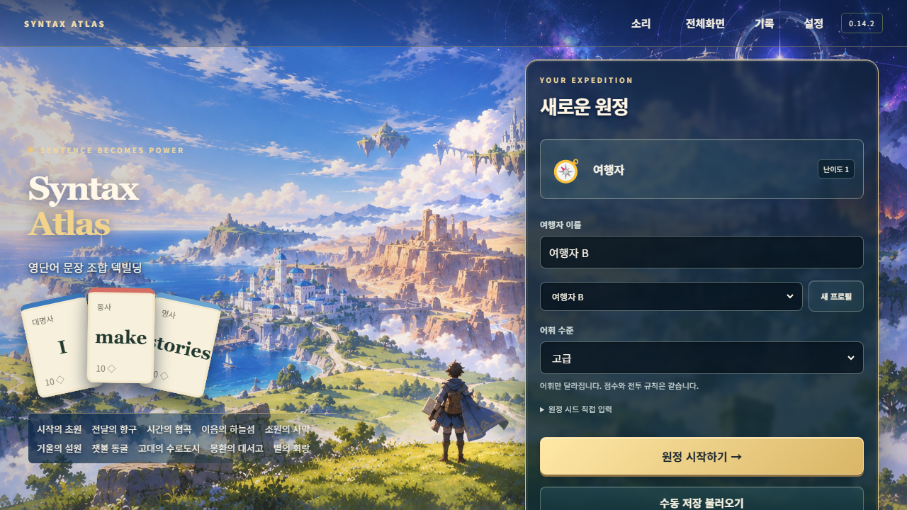
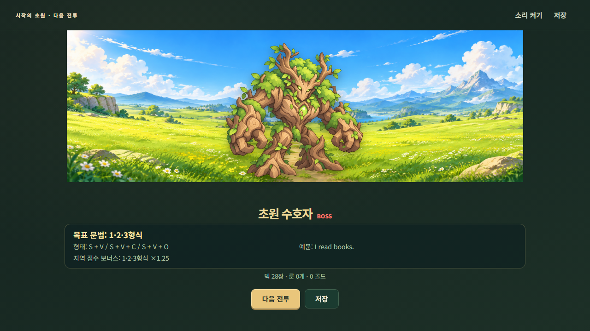
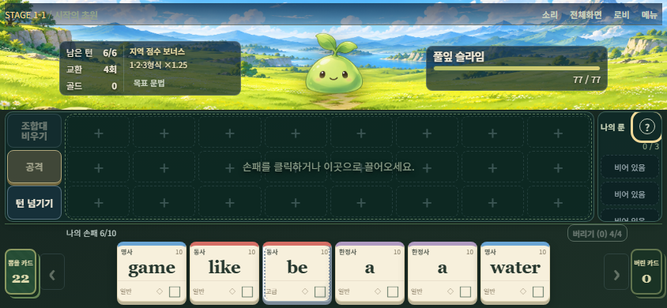

# 0.14.2 Copy & Clarity — 실제 구현 결과

기준은 PR #36 병합을 확인한 최신 `origin/main` **2082aff8a5c24b290901f300f2c844ffdc402d00**이다. 시작 작업 트리는 clean, 후속 브랜치는 `codex/v0.14.2-copy-clarity`다. v0.14.1 커밋 41a6ac1을 포함하며 과거 main으로 되돌리지 않았다.

## 변경과 경계

- 준비: 붉은 BOSS, 1·2·3형식, 실제 해석 틀만 뜻으로 표시. 처치 지시와 초원 공통 명령문 설명을 제거했다. 지역 점수 보너스·저장으로 통일했다.
- 전투: 짧은 행동명, 실제 남은 교환/규칙 한도, 페이지 전체 선택 수, 손패 제목 하나, 숫자만인 더미 수량, 나의 룬 ? 도움말. 체크 재탭·Escape·페이지와 기존 버튼 위치를 유지한다.
- 영문 몬스터명은 현재 한국어 표시 별칭으로 대응하는 표시 전용 번역안이다. 기존 nameEn 우선, 구버전 회랑 이름도 별도로 대응한다. 춤추는 광대에는 현재분사 분사구문과 실제 배율을 표시하며 도움말에는 기존 전체 보너스 조건을 남겼다.
- 로비: 요청 카피와 현재 1~10지역 이름만 표시한다. 어휘 수준은 초급/중급/고급/자유로 표시하며 enum과 풀은 그대로다. 총 전투 수 예고는 표시에서만 제거했다.
- 기존 이름은 읽기 전용이며 로비 제출과 startRun 양쪽에서 보존한다. A/B 및 같은 이름의 다른 ID, 새 프로필 임시 입력, 실제 이름 누락 프로필을 구분한다. 누락 복구는 기존 ID에 저장한다.
- 앱/package만 **0.14.2**. 원정/언어/채점/저장은 **0.14.0**. 의존성·게임/엔진·저장 서비스·오디오·PWA·에셋·워크플로에 변경이 없다. main.js 변경은 기존 이름 보존 한 줄이다. 학습 안내 데이터만 수정하고 실제 보너스/HP/50전투/덱/RNG를 변경하지 않았다.

주요 파일은 `ui/lobby.js`, `main.js`, `ui/progression.js`, `ui/combat.js`, `ui/displayText.js`, `ui/targetGrammar.js`, `ui/viewport.js`, `data/battleLearningGuide.js`다. 관련 CSS와 튜토리얼·버튼 표시, 앱 버전·문서·검사를 함께 갱신했다. 새 원화/게임 기능/테스트용 플레이 버튼은 없다.

## 실행 결과

기존 Node 24.19.0/npm 11.17.0/Playwright 1.51.1 환경을 재사용했다. [명령·시간·종료 코드](evidence-copy0142/commands.json).

| 명령 | 종료 | 실제 결과 |
|---|---:|---|
| npm.cmd test | 0 | **1,999 PASS**, FAIL/skip 0 |
| npm.cmd run build | 0 | PASS, 기존 500kB chunk 경고 유지 |
| node tests/copy-clarity-browser.mjs | 0 | 새 UI 4개 흐름 PASS |
| node tests/ui-feedback0141-browser.mjs --no-captures | 0 | 기존 집중 회귀 6개 흐름 PASS |
| node tests/comma-browser.mjs --no-captures | 0 | 기존 쉼표 3개 흐름 PASS |

브라우저는 `SB_BASE_URL=http://127.0.0.1:5174/`의 Chromium 자동화다. PC1280×720, 태블릿1024×768, 휴대폰844×390 및 844×310을 확인했다. 실제 Controller 제출·확정 감점·IndexedDB 저장을 포함하지만 지정 상태 검사이며 자연 완주나 실기기 결과가 아니다.

초기 하네스에서 한 페이지 화면에 다음 페이지를 요구했고 시작 손패를 8장으로 가정했다. 실제 두 페이지 화면과 상태의 장수로 바로잡았다. 기존 쉼표 검사도 변경된 ‘기록’ 버튼명을 반영했다. 실패 로그는 `.local-validation/v0142/`에 보존했다. 기존 고정 timing/reward 증거는 래퍼로 복원했다. 쉼표 검사의 기본 임시 result 경로는 갱신되었으며 이번 결과를 위 evidence 폴더에 별도 보관했다. 과거 커밋된 보고서·캡처는 변경하지 않았다.

기존 기대값 수정은 앱 버전과 요청된 라벨/저장 버튼 위치 선택에 한정한다. 게임 기대값/assertion/skip은 변경하지 않았다. 나머지 옛 standalone 브라우저 묶음은 실행하지 않았다.

## 5개 흐름 / AC 근거

[로비·준비·손패·룬 결과](evidence-copy0142/copy-ui.json), [v0.14.1 회귀](evidence-copy0142/feedback.json), [쉼표 회귀](evidence-copy0142/comma.json). PASS는 아래 자동화 또는 코드 대조 범위다.

| AC | 상태 | 근거 |
|---|---|---|
| 01 | PASS | Git 기준/조상 확인, 기존 피드백·이미지 focused 회귀 |
| 02 | PASS | T2 실제 보스 준비 BOSS, 대표 화면 붉은 표시 |
| 03 | PASS | T2 초원 수호자 목표, 뜻/명령문 안내 없음 |
| 04 | PASS | T2 준비, T4 전투, targetGrammar 코드 대조 |
| 05 | PASS | 로비/준비 자동 검사, UI 전체 총수 문구 검색·진행 엔진 diff 없음 |
| 06 | PASS | T3 행동·기록·저장 연결, 기존 마지막 턴 경고 코드/단위 회귀 |
| 07 | PASS | T3 두 페이지 선택·교환 4→3, 지정 실제 한도 2/5 표시 |
| 08 | PASS | T3/T4 손패 제목·페이지·선택 해제 버튼 없음 |
| 09 | PASS | T3 재탭/Escape, 기존 빈 손패/전투 구역 경로 유지 |
| 10 | PASS | T3 더미 숫자, 실제 배열 길이를 표시하는 코드 대조 |
| 11 | PASS | T4 키보드 도움말·상태 동일, 룬 순서/봉인/발동 코드 미변경 및 단위 회귀 |
| 12 | PASS | 전투 영문명 DOM, 현재/구버전 전체 몬스터 표시 맵 단위 검사 |
| 13 | PASS | T2 광대, 표시 단위 검사·전체 보너스 조건 유지 |
| 14 | PASS | T4 대표 크기·모바일 자원, 대표 화면과 패널 내부만의 CSS 변경 |
| 15 | PASS | T1 로비 문구/중복 제거 및 화면 |
| 16 | PASS | T1 현재 데이터 10지역, FINAL 제외 |
| 17 | PASS | T1 네 라벨/ADVANCED 저장, 풀 미변경 |
| 18 | PASS | T1 실제 프로필 생성·전환·readonly·stale값 방어·같은 ID의 누락 이름 복구 |
| 19 | PASS | T4 크기/310px 접근 + T5 기존 6+3개 회귀(실제 공격·쉼표·INSERT/SWAP·형태/감점·이미지·전체화면·구저장) |
| 20 | PASS | 최종 검사/보고·개발 브랜치 인계, 배포 없음 |

## 대표 화면 3장

## 남은 한계

실제 iPad/iPhone/Android·인앱 브라우저 터치/청취는 **NOT RUN**. 자연 50전투, 대량 seed, 전 브라우저 순회는 **NOT RUN**이며 이번 완료 조건으로 확대하지 않았다. 이번에는 언어 엔진 변경이 없어 별도 validate:data 로컬 실행은 하지 않았다. 소소한 간격/번역 표현은 사용자 피드백으로 조정한다. 기존 큰 bundle 경고 외에 확인한 기능 차단은 없다.

main 병합·자동 병합·Pages 설정 변경·공개 배포는 하지 않는다. 커밋과 PR은 최종 인계 메시지에 기록한다.
