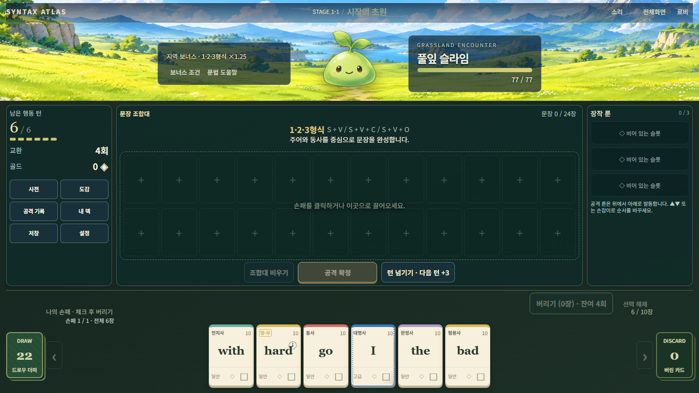
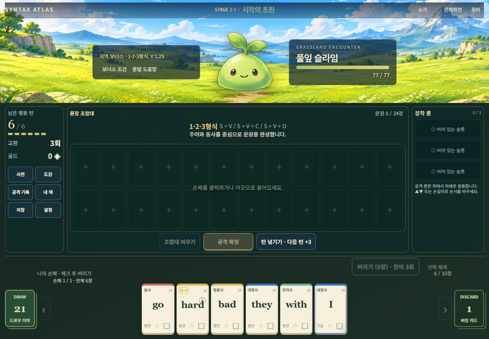

# 0.12.2 접속·입력 안정화 — 실제 결과

2026-11-05. 시작 main `cc802001556f88ec210a5d237ccb6c9fc9a26dd4`, 브랜치 `codex/v0.12.2-device-stability`. fetch 후 이전 0.12.1 PR 병합 및 깨끗한 작업 트리를 확인했다. 기존 브랜치·ZIP·실행 증거를 보존했다. [구현 계약](../spec/v0.12.2/Syntax_Atlas_0.12.2_Device_Stability_Spec.md) / [원본 체크리스트](../spec/v0.12.2/CHECKLIST.md).

## 변경과 재현

- 실제 Chromium 입력으로 이전 마지막 move는 조합대, pointerup은 화면 바깥에 놓았다. 이전 코드는 카드 1장을 이동했고, 수정 후 0장 이동한다. drop은 pointerup 최종 좌표를 사용한다.
- 실제 CDP touch 이벤트로 드래그 중 두 번째 손가락을 추가했다. 이전 ghost 1개 → 수정 후 0개. 관련 손가락이 모두 떨어질 때까지 취소 상태를 유지하며 이후 정상 탭을 즉시 받는다.
- `cards.js`/`runes.js`: capture 해제 전에 active 소유권을 지우고, 취소·lost capture·view 교체는 멱등적으로 정리한다. 연결된 카드/current revision/조작 가능 상태를 확인한다. ghost는 현재 fullscreen host에 원래 누른 위치를 기준으로 배치한다. 원본 카드/UI는 이동시키지 않는다.
- `inputGuard.js`: 앱당 한 번 등록한다. 같은 제스처의 호환 click, 취소된/분리된 target만 차단한다. 시간 기반 전역 debounce를 사용하지 않는다. blur/숨김/페이지 복귀/라우팅의 낡은 입력을 정리하며 trusted document 오디오 리스너는 계속 실행된다.
- `input.css`: 게임 카드·버튼은 `none`, 일반 게임 면은 `pan-x pan-y`, 대화상자 scroller는 `pan-y`로 구분한다. `manipulation`만으로 끝내지 않으며 body/#app 전체 none, 전역 overflow 차단, 모든 touch preventDefault를 추가하지 않았다. 입력/키보드/복사/슬라이더 및 좁은 화면의 가로 접근은 유지한다.
- `viewport.js`: 같은 치수 알림은 드래그를 취소하지 않는다. 실제 치수/scale/offset/fullscreen host 변화만 취소한다. PC 수동 확대를 강제로 되돌리지 않는다.
- `appVersion.js`, 로비, package/lockfile 루트 표시만 **0.12.2**. 원정·언어·점수·저장 계약은 **0.12.1**. 의존성 변경 없음.

게임 데이터, 문법/점수/룬/보스/50전투, RunController, 저장/랭킹, 오디오/MusicDirector, 공격 presentation, 기존 시각 CSS·에셋·workflow는 변경하지 않았다. 오디오·base URL·전체화면 fallback·전투 전 idle은 기존 구현을 확인하고 보존했다. 함수 존재만으로 새 PASS를 기록하지 않았다.

## 실제 실행

Windows, 기존 로컬 Node 24.19.0 / npm 11.17.0 / Playwright 1.51.1 Chromium 134.0.6998.35. PC 1366×768 및 trusted 전체화면, 태블릿 가로 1180×820, 좁은 가로 844×390 에뮬레이션. DEV `http://127.0.0.1:5173/`, production은 임시 로컬 포트의 `/grammardealer/`에 실제 dist를 제공했다. 개인 브라우저/프로필은 사용하지 않았다.

| 명령 | 종료 | 이번 실제 결과 |
|---|---:|---|
| `npm.cmd test` | 0 | **PASS 1918**, fail/skip 0. 새 작은 입력 검사 7개 포함 |
| `npm.cmd run build` | 0 | **PASS**. 기존 500kB chunk 경고 유지 |
| `node tests/patch-input-browser.mjs` | 0 | **PASS**, 기존 버리기·이동·형태 3묶음 |
| `node tests/gamefeel-browser.mjs` | 0 | **PASS 11묶음**, 실제 timeline/집결·돌진·타격/정산 1회/음량/BGM/fallback |
| `node tests/device-stability-browser.mjs` | 0 | **PASS 5묶음**, A~D/F 입력·복귀 및 지정 룬/14장 페이지 |
| `node tests/device-stability-browser.mjs --audio` | 0 | **PASS 1묶음**, 첫 trusted 에뮬레이션 탭 및 suspended 재시도, mute/0 보존 |
| `node tests/device-stability-browser.mjs --production` | 0 | **PASS 2묶음**, subpath·실제 저장/불러오기·선택 자산 실패 |

최종 게임 소스 변경 후 필수 명령을 한 번씩 실행했다. 기존 assertion/skip/허용오차는 변경하지 않았다. 단위검사의 고정 timing/reward 증거와 기존 브라우저 캡처는 이번 결과를 로컬 별도 폴더에 보관한 뒤 원래 파일을 복원했다. [간결한 실행 메타데이터·측정값](validation/v0.12.2/result.json). 전체 원본 로그는 `.local-validation/v0101/v0122-*`, 재현 전후는 `.local-validation/v0122/`에 보존한다.

## A~F 결과와 한계

| 묶음 | 상태 | 실제 근거 / 미실행 경계 |
|---|---|---|
| A 접속·재진입 | PASS (자동화) | production hash 직행/새로고침 → 로비, 실제 튜토리얼 스킵·슬롯 저장/불러오기, hand ID/text 동일. JS/CSS/이미지 subpath 200. 의도적으로 이미지/음원을 차단해도 시작·소리 패널 조작 가능. DEV history 뒤/앞, 전체 저장 상태 동일 |
| B 탭·드래그 | PASS (자동화) | 빠른 3장 탭=revision +3, 삽입/재정렬/최종 바깥 drop, 두 손가락 이동 후 scale 1 및 카드/RNG/턴 보존. cancel/lostcapture는 합성 이벤트, 다중 touch는 CDP. 실제 기기 pinch **NOT RUN** |
| C 스크롤·입력 | PASS (자동화) | 실제 사전 wheel 스크롤/검색, 형태 선택, 버리기 선택/확정, 14장 페이지 지정 상태, slider 키보드/값 변경, 주소 선택/실패 시 수동 복사 안내. 입력이 뒤 카드에 관통하지 않음. 실기기 OS 키보드/클립보드 **NOT RUN** |
| D 전체화면·수명 | PASS (자동화) | fullscreen ghost host/drop, 같은 resize 알림 유지/실제 치수 변화 취소, 다음 입력 정상. 대표 tablet 및 좁은 가로 접근. 기존 정상/2배속/감점/방어 공격 각 1회 정산. hidden/blur/복귀 일부는 합성 lifecycle. 실기기 회전·카톡 **NOT RUN** |
| E 오디오 | PASS (자동화) | 첫 touch 후 NONE→running, suspend→trusted retry, muted=true/gain=0 유지. 기존 BGM decoded source 종료→약 1초 gap→신곡, 동시 source 최대1, 상점/빠른 진입/로비 취소 검사. 청취·iPad interrupted 상태·실기기 앱 복귀 **NOT RUN** |
| F 보존 | PASS (자동화·diff) | 같은 seed/1366×768의 주요 6영역 rect 모두 이전과 동일, 카드 87.484×120px·하단14px 그대로. 전체 0.12.1 저장 state(사본/RNG/룬/골드/턴 포함) 재로드 동일, 28장. production에 새 fixture 메뉴 없음 |

기존 작은 화면 최소 폭 1160px 및 가로 스크롤 정책을 보존했다. 844×390에서 그 접근 경로가 남는지 확인했으며 모바일 레이아웃 개선을 주장하지 않는다. OS 확대/PC 수동 확대를 막지 않는다. Stage3 이후 미등록 BGM 무음은 기존 정책이며 실패로 분류하지 않는다. 실제 청취는 AudioContext/source/HTTP 결과로 대체하지 않는다. 전체50전투·대량seed·전 기기/브라우저 순회·별도 `validate:data`는 이번 범위 밖 **NOT RUN**. 공용 랭킹 상태는 변경하지 않았다.

초기 수정 후 재현 스크립트는 정상 취소로 조합대가 비어 비우기 버튼이 비활성화되자 시간초과했다. 이 실행을 PASS로 사용하지 않았고, 불필요한 비우기를 조건부로 수행하는 관찰 스크립트로 다시 측정했다. 게임 동작/assertion 완화로 우회하지 않았다. 최종 필수/집중 검사에 남은 FAIL은 없다.

## 대표 화면 3장

같은 seed·같은 viewport의 전후이며 대기 애니메이션 시점은 다를 수 있다. 크기/배치 diff가 아닌 입력 정책만 변경했다.

작업 브랜치의 검토용 PR로 인계한다. main 병합, auto-merge, Pages 설정 변경, 공개 배포는 수행하지 않는다.
