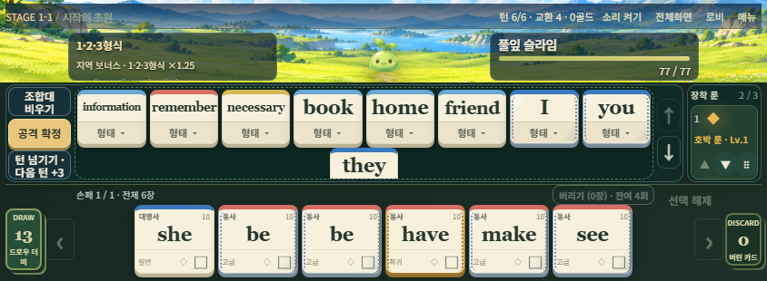
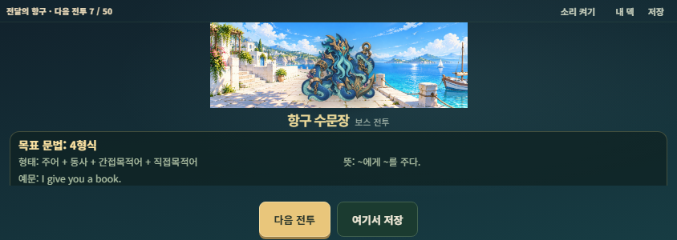

# Syntax Atlas 0.13.1 · 링크 진입과 가시 영역 검증

기준은 2026-11-14 작업 시작 시점의 `origin/main@cf4d46f0f94cd2a7db3d887320f808530209b8e2`(PR #33)이다. 브랜치는 `codex/v0.13.1-immersive-link-viewport`, 검증한 구현 커밋은 `20ad7c4105c000ec99628c017bf9fe1a6e246ddb`이다. 명세와 현재 소스의 화면·저장 계약을 대조했다. [구현 명세](../spec/v0.13.1/Syntax_Atlas_v0.13.1_Immersive_Link_Responsive_Spec.md)

## 사용 흐름

학교나 가정에서 기존 공식 링크를 열면 로비에서 원정을 바로 시작할 수 있다. 가로 휴대기기의 첫 원정 시작 또는 전체화면 버튼은 사용자 제스처 안에서 Fullscreen API를 호출한다. 실제 전체화면 요소가 생기면 가로 잠금을 요청한다. 방향 잠금만 거절돼도 이미 시작한 전체화면을 사용할 수 있다. 시작 시 거절되면 원정은 계속 진행하고, 버튼을 명시적으로 눌러 거절된 경우에는 복사·계속 플레이가 가능한 안내가 열린다. 안내 바깥의 게임 입력도 가능하다. [공식 게임 주소](https://yeomt.github.io/grammardealer/)

설정의 ‘공식 링크 · 홈 화면 안내’에서 홈 화면 추가 방법과 브라우저별 저장소 차이를 확인할 수 있다. 설치형 표시 모드는 미디어 쿼리와 iOS standalone 신호로, 시스템 전체화면은 실제 전체화면 요소로 판단한다. manifest의 `id`·`scope`는 `/grammardealer/`, `start_url`은 `/grammardealer/#lobby`이다. `standalone`은 설치형 창의 기본 표시 방식이고 `landscape`는 선호 방향이다. 새 아이콘은 기존 풀잎 슬라임 원본 `public/assets/stages/stage-01/monsters/01_idle.png`에서 만든 180·192·512px PNG다. 실행에 서비스워커를 등록하지 않는다.

## 측정

Chromium 134.0.6998.35 / Playwright 1.51.1에서 레이아웃 크기를 고정하고 테스트 문서의 VisualViewport 높이·오프셋만 변경했다. 실제 주소창을 움직이거나 실기기 키보드를 연 결과는 아래 실기기 표에 따로 표시한다.

| 조건 | 변경 전 | 변경 후 |
|---|---|---|
| 844×390, 가시 높이 390 | 무대 105px, 손패 하단 382px | 무대 105px, 손패 하단 382px |
| 같은 창, 가시 높이 310 | 손패 하단 321px로 11px 가려짐 | 손패 하단 302px, 무대 57px. 복구 후 무대 105px |
| 가시 높이 236 | 소리 창 하단 307px | 소리 창이 6~230px 안에 표시됨. 전투는 236px 스크롤 영역 속 297px 콘텐츠로 손패·비우기 직접 조작 |
| 915×412 → 가시 높이 312 → 412 | — | 무대 127 → 59 → 127px |
| 1024×768 → 678 → 768 | — | 무대 145 → 55 → 145px, 태블릿 3열 |
| 1194×834 → 734 → 834 | — | 무대 211 → 111 → 211px, 태블릿 3열 |

태블릿 지정 보스전도 별도로 측정했다. 1024×768의 가시 높이 668px 조건에서 골렘 부위가 조합대 시작 위치보다 61px 아래까지 나왔다. 휴대기기 무대가 200px 미만일 때 같은 부위 노드를 HP 패널 안에서 스크롤하고, 공간이 충분하면 별도 행으로 되돌린다. 전후 Controller 상태 일치와 마지막 부위의 실제 가시 경계를 확인했다.

두 그림은 해당 가시 사각형의 캡처다. 최대 카드·보스·상점은 지정 상태로 검사했고, 새 원정 시작·실제 공격·저장/불러오기는 앱의 UI 경로로 검사했다.

## 변경 위치

| 파일 | 역할 |
|---|---|
| `src/ui/visualViewport.js`, `deviceLayout.js`, `viewport.js`, `src/main.js` | 레이아웃을 휴대폰/태블릿으로 분류하고 별도로 가시 사각형을 계측한다. 유효한 변경을 프레임당 한 번 발행한다. 확대 중에는 마지막 레이아웃을 유지한다. |
| `src/ui/visibleLayout.css`, `responsive.css`, `mobile.css`, `panorama.css`, `combat.js` | 안전 영역을 한 번만 차감하는 스크롤 영역, 가변 전투 높이와 보스 패널, 실제 사각형 중앙의 모달, 준비 화면과 기타 화면의 스크롤 경로 |
| `src/ui/immersive.js`, `orientation.js`, `lobby.js`, `overlays.js`, `inputGuard.js` | 사용자가 누른 시점의 진입 요청, 단일 진행 요청, 거절·직접 회전·복사 안내와 설정 경로. 게임 명령은 기존 핸들러가 처리한다. |
| `index.html`, `public/manifest.webmanifest`, `public/icons/atlas-{180,192,512}.png` | Pages 하위 경로에서 열리는 manifest와 사용자 에셋 파생 아이콘 |
| `src/appVersion.js`, `package.json`, `package-lock.json` | 앱/패키지 표기 0.13.1. 원정·언어·저장 계약은 0.12.1이며 lockfile의 루트 버전 2곳만 수정했다. |
| `tests/immersive-link.test.js`, `tests/helpers/link-viewport-browser.js`, `tests/{device-layout013,device-input}.test.js`, `tests/{panorama-mobile-browser,gamefeel-browser,device-stability-browser}.mjs` | 가시 높이·저장 상태·실제 입력·manifest 회귀와 명세에 따른 기존 기대값 정정 |

기존 검사의 변경 이유는 동기 이벤트마다 중복 발행하던 측정의 프레임 병합, localhost 대신 공식 주소 복사, 전체화면 실패 안내의 비차단 동작, 가용 무대에 따른 골렘 위치와 앱 버전 표기다. 낮은 무대의 골렘을 기존 데스크톱 둘째 행에 두라는 기대는 실제 겹침을 만들었다. 짧은 화면에서 스크롤해 마지막 부위를 읽고 충분히 높은 화면에서 원래 행으로 복귀하는 두 경로를 검사한다. `src/engine`·`src/game`·`src/data`·`src/services`·원본 아트/BGM·배포 워크플로에는 변경이 없다.

## 실행 결과

| 명령 | 실제 결과 |
|---|---|
| `npm.cmd test` | PASS, 1,934개 통과, 실패 0, skip 0, 종료 0 |
| `npm.cmd run build` | PASS, 종료 0. Vite 8.3.2, JS 697.10kB의 청크 크기 경고 |
| `node tests/panorama-mobile-browser.mjs --section=<이름>` | `link-entry`, `visible-battle`, `visible-panels`, `actual-flow`, `card-rune-input`, `mobile-attack`, `saved-preparation`, `focused-modal-captures` 각각 PASS, 종료 0 |
| `node tests/device-stability-browser.mjs` | 기본 5묶음 PASS, 종료 0. `--audio` 1묶음, `--production` 3묶음 각각 PASS, 종료 0 |
| `node tests/gamefeel-browser.mjs` | 11묶음 PASS, 종료 0. 실제 BGM 버퍼 전환, 모의/실제 fullscreen 경로, 정상·감점·방어·빠른 공격 및 연출 정산 검사 |

최초 보완 뒤 기존 넓은 화면의 골렘 부모 기대값이 실패한 로그도 보존했다. 최종 수용력 조건을 반영한 검사로 재실행했다. 원본 로그는 로컬 `.local-validation/v0131/`, 최종 단위 TAP는 `.local-validation/v0101/immersive-0131-final/`에 있다. 기존 고정 테스트 증거는 실행 후 복원했다.

## AC01~AC32

PASS는 근거 열에 적힌 구현 및 실행 환경에서의 판정이다. 실제 OS·앱 조합은 다음 표에 기록했다.

| 조건 | 상태 | 실제 근거와 범위 |
|---|---|---|
| AC01 | PASS | 미설치 새 프로필로 production 하위 URL·해시 진입, 새로고침·플레이. QR 스캔/메신저 실기기 NOT RUN |
| AC02 | PASS | trusted 탭 → 실제 Chromium fullscreenElement 확인 → lock('landscape') 호출. 잠금 거절 주입 후 fullscreen 유지. WebKit void 요청은 모의 이벤트 단위 검사 |
| AC03 | PASS | API 없음과 권한 거절, 비차단 안내·현재 화면 계속. 최초 원정 시작 요청 거절 후 한 번의 submit으로 실제 지역 입장 |
| AC04 | PASS | 전체화면 왕복·가시 높이 변경 전후 RunState·선택 카드·손패 페이지·룬 스크롤 동일. 오디오 버퍼/설정 검사는 별도 실행 |
| AC05 | PASS | 회전 안내 탈출·재회전, 키보드 높이 축소와 실제 수평/수직 방향 구분 |
| AC06 | PASS | 링크 진입 및 미설치 원정 시작, 설정에서 선택적으로 홈 화면 안내 열기. 카카오·인스타 실기기 NOT RUN |
| AC07 | PASS | 공식 URL을 받는 테스트 clipboard, 쓰기 거절 시 주소 선택/직접 복사·저장 분리 안내 |
| AC08 | PASS | dist를 실제 /grammardealer/로 서빙. manifest·start URL·scope·id·아이콘 3종 HTTP 200 및 PNG 크기 확인 |
| AC09 | PASS | standalone 미디어 쿼리 모의, fullscreenElement 없음/aria-pressed=false. 설치형 창에서 시작 시 추가 요청 0회 |
| AC10 | NOT RUN | 실제 설치 후 재실행·버전 갱신. production에서 대체 실행 URL 로드 및 SW 등록 0건은 PASS |
| AC11 | PASS | 844×390→310에서 손패·공격·턴 넘기기·버리기 실측 |
| AC12 | PASS | 세로 공간 축소·회복 전후 무대 높이와 손패 경계 비교 |
| AC13 | PASS | fullscreen 왕복·회전·pageshow/숨김 계측, 태블릿 창 크기/가시 높이 변경, UI 재조작. 실제 iPad 멀티태스킹 NOT RUN |
| AC14 | PASS | 모의 좌·우·상·하 inset 및 visual offset을 합성해 #app·소리 창·조작부 경계 확인. 물리 노치/홈바 NOT RUN |
| AC15 | PASS | 낮은 화면에서 1·7·8·9·16·24장 순서, ↑↓·마지막 형태 버튼. 실제 앱에서 형태 변경 |
| AC16 | PASS | 여러 페이지에서 선택/교환 1회, 가시 높이와 fullscreen 왕복 후 페이지·체크 유지 |
| AC17 | PASS | 제한된 룬 패널 스크롤 위치, 실제 소유 순서와 ▲▼·드래그·상세 |
| AC18 | PASS | 골렘/빙결핵/이중 인장 표시, 태블릿 마지막 부위 접근·공간 회복 시 재배치. 활성 전투 데이터 일치 |
| AC19 | PASS | 가시 높이 212px와 offset을 준 로비에서 이름 입력·Enter 확정·원정 시작. 실기기 IME NOT RUN |
| AC20 | PASS | 짧은 지역 입장·카드 선택 및 3:1 준비 파노라마, 저장/다음 각각 한 번. 준비 상태 재시작/로드 검사 |
| AC21 | PASS | 낮은 화면에서 상품 페이지·구매 버튼·나가기 도달, 재고 동일. 보상 3택·건너뛰기·offer 동일 |
| AC22 | PASS | 실제 가시 사각형 안의 모달 헤더/닫기, 사전 검색·스크롤·형태·설정 슬라이더·저장 |
| AC23 | PASS | 가시 높이 236px에서 297px 콘텐츠를 스크롤, 손패 카드 배치·조합대 비우기 성공 |
| AC24 | PASS | PC 1280×720/1920×1080의 전투·버튼 경계, 키보드 진입/종료, 마우스 휠·드래그. 확대 중 레이아웃 유지 단위 검사. 실제 브라우저 메뉴 수동 확대 NOT RUN |
| AC25 | PASS | 실제 드롭·두 손가락 취소/다음 입력, 변경 없는 resize와 실제 좌표계 변경을 구분. 카드·유령 정리 |
| AC26 | PASS | 연속 탭·회수·형태·버리기·드래그·공격 및 기존 턴 명령 회귀 |
| AC27 | PASS | CHARGE 중 가시 높이/offset와 창 크기 변경, 실제 복사본 LUNGE·피격 1회·정산 1회·cleanup. 기존 fullscreen/점수 앵커 검사 |
| AC28 | PASS | 첫 탭 및 suspended 재개, 음소거·0, BGM 소스·버퍼 전환. 실기기 청취 NOT RUN |
| AC29 | PASS | 동일·변경 resize/scroll 30회 묶음의 rAF 1회, 동일 치수 통지 억제·구독 cleanup, 무효 측정/확대 유지. 지정 브라우저 흐름 pageerror 0 |
| AC30 | PASS | 저장 슬롯 왕복의 카드·RNG 등 전체 RunState 비교 및 기존 전체 단위의 문법·보상·피해·멱등성 회귀 |
| AC31 | PASS | 위 명령의 종료 결과 및 로컬 production 하위 경로 |
| AC32 | PASS | 구현 변경·명세·검증 범위·실기기 상태·브랜치와 PR 인계 |

| 실환경 | 상태 |
|---|---|
| 학교 iPad Safari / Android 태블릿 Chrome의 QR 첫 접속, 실제 브라우저 바와 회전 | NOT RUN |
| 가정 iPhone Safari / Android Chrome의 기기 터치, 키보드, OS 가로 잠금, BGM 청취 | NOT RUN |
| 카카오톡·인스타그램 인앱의 실입장, 복사 후 브라우저 이동, 실제 홈 화면 설치·재실행 | NOT RUN |

브라우저가 극도로 낮으면 한 번에 모든 카드를 볼 수 없어 스크롤이 필요하다. 외부 브라우저로 옮기면 저장 공간이 다를 수 있다. 실제 지원 여부와 권한은 브라우저가 결정한다. [Fullscreen API](https://developer.mozilla.org/en-US/docs/Web/API/Element/requestFullscreen) · [VisualViewport](https://developer.mozilla.org/en-US/docs/Web/API/VisualViewport) · [화면 방향 잠금](https://developer.mozilla.org/en-US/docs/Web/API/ScreenOrientation/lock)
