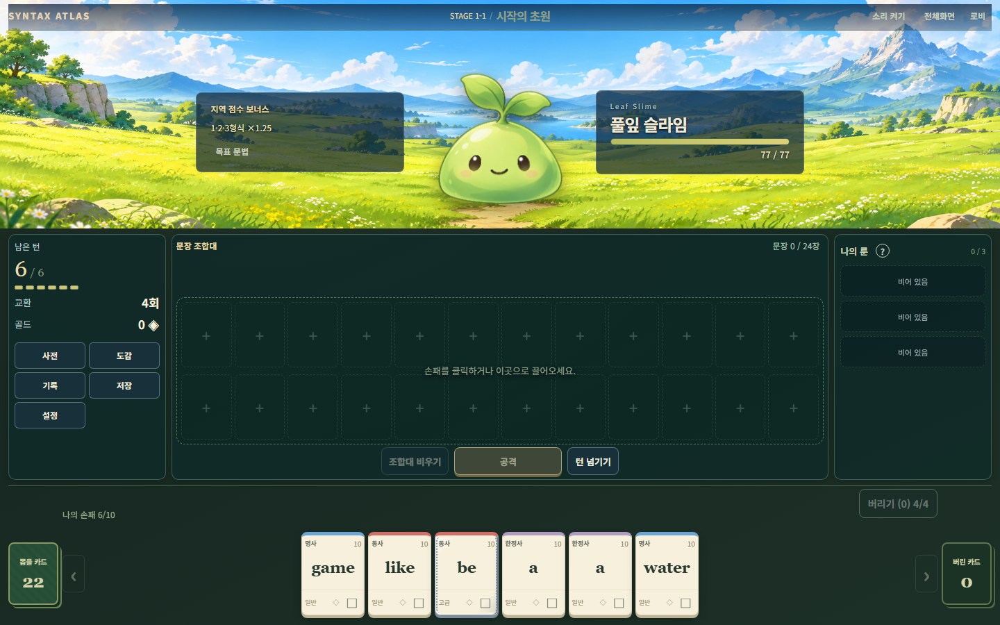
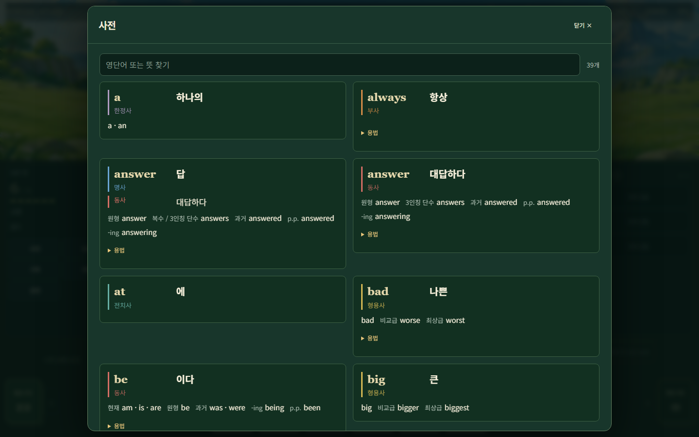
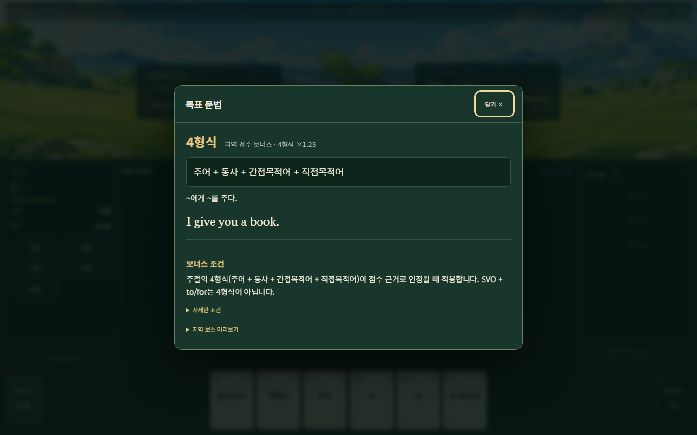
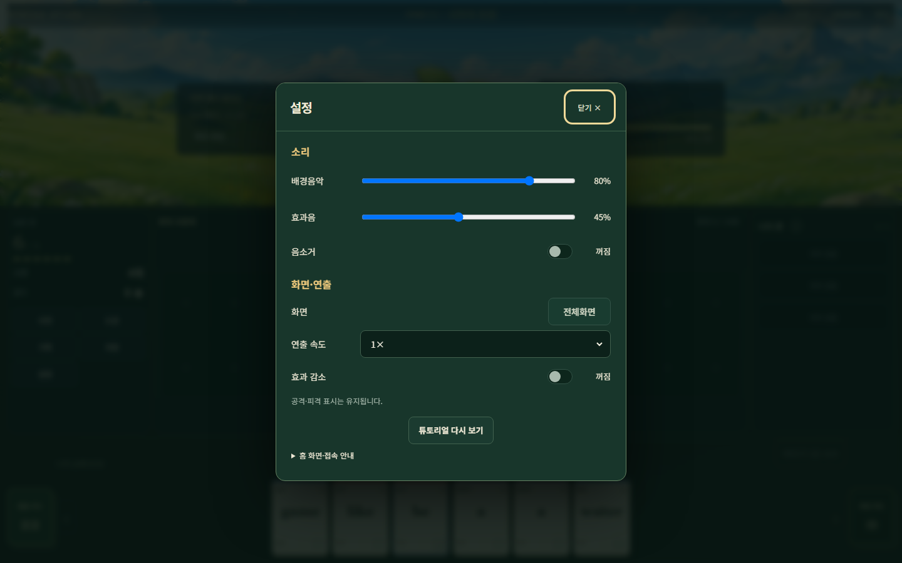
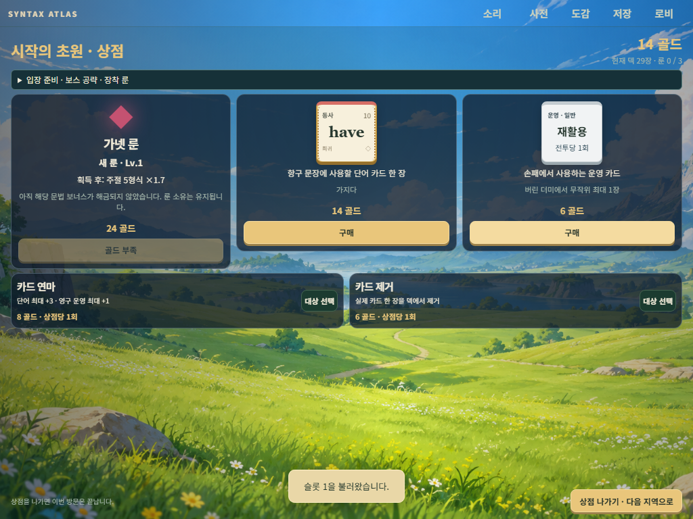
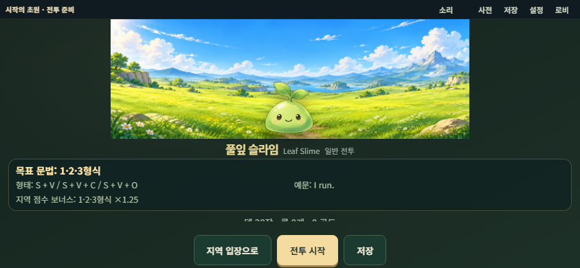

# v0.15.1 R2 — Interface Cohesion & Readability

2026-11-17. 기준 `origin/main@d7d86e1f3e508e9b4beb31ec6deafdf440a2a0d1`(PR #38, v0.15.0). 시작 작업 트리는 깨끗했다. 이전 `codex/v0.15.0-play-feedback` 브랜치와 인계 ZIP·기존 증거를 보존하고 `codex/v0.15.1-interface-cohesion`에서 구현했다. [R2 명세](../spec/v0.15.1/Syntax_Atlas_v0.15.1_Interface_Cohesion_Spec.md)가 기준이며 R1의 카드 통합창/탭은 구현하지 않았다.

## 변경과 상태 경계

- **사전만 유지:** 전투/모바일 메뉴/입장/준비/보상/상점의 일반 `내 덱` 버튼을 제거했다. 영어·한글 뜻 첫 줄, 아래 품사, 실제 카드 품사색, 간결한 활용형/검색/개수로 표시한다. 만난 단어·겸용 뜻·지원 형태는 유지하고 보유/희귀도/연마/점수와 보유 필터는 제거했다. 역사적 `openDeck(all)`도 사전으로 연결한다. 실제 뽑을/버린/사용 완료 묶음은 기존 영역만 읽는다.
- **목적별 팝업:** 설정 560px, 문법 720px, 사전 1080px 상한에서 실제 가시 영역을 적용한다. 짧은 가로 설정은 두 그룹과 본문 한 곳의 스크롤을 사용한다. native checkbox 기반 스위치의 라벨/Space는 한 번만 변경한다. 다른 확인/형태/기록/저장 팝업은 기존 폭이다.
- **상점 장소:** `presentationRegion`을 이름·팔레트·기존 배경·BGM이 공유한다. 대상 2/4/6/8/10/final의 장소는 각각 1/3/5/7/9/10이다. `shop.stageId`, 상품/가격/구매/서비스/지급/RNG는 그대로다. 4·8 선택은 다음 지역 준비라고 구분하며 legacy 시작 상점은 당시 장소를 유지한다. 미등록 지역의 배경·BGM을 새로 만들지 않았다.
- **첫 준비:** 현행 일반 원정 1~10지역/최종 지역의 읽기 전용 UI 게이트다. 원정 상태를 복제 dispatch하거나 새 저장 필드를 만들지 않는다. 기존 정적 encounter/목표를 읽고 확인에서 기존 START_BATTLE/ENTER_STAGE를 한 번 실행한다. owner/run/stage/encounter/revision으로 낡은 콜백을 막는다. 실제 guided는 바로 실습, 구전투 저장은 기존 전투로 복구, BETWEEN_BATTLES는 기존 다음 적이다.
- **버전:** 앱/패키지만 0.15.1. 원정·언어·저장 기본 0.14.0, playFeedbackPolicy/ruleset 0.15.0 그대로다. `src/data`, `src/game`, `src/engine`, audio/localStore, 카드 렌더러, 입력/가시 영역/모바일 배치, public 에셋은 diff가 없다. lockfile은 앱 버전 두 곳만 변경했고 의존성 트리는 동일하다. HP/피해/경제/카드/보스/50전투 정산은 수정하지 않았다.

주요 변경 파일: `main.js`, `services/presentationRegion.js`, `services/musicContext.js`, `ui/firstPreparation.js`, `ui/interfaceCohesion.css`, `ui/{combat,dom,formView,guidedCoach,overlays,progression,shop,targetGrammar,theme}.js`. 검사 파일 2개 추가와 관련 기존 기대/fixture 3곳, 앱 버전, 인계/구조/변경 문서와 R2 명세를 포함한다.

## 실제 검사

Windows / Node 24.19.0 / npm 11.17.0 / Playwright 1.51.1 Chromium. 기존 `.local-tools`와 lockfile 설치 환경을 재사용했다. 개발 서버는 `npm.cmd run dev -- --host 127.0.0.1 --port 5174 --strictPort`. 격리 프로필만 사용하고 실제 사용자 저장은 건드리지 않았다. 아래 명령은 checkout 루트에서 실행했다.

| 명령 | 종료 | 결과 |
|---|---:|---|
| `npm.cmd test` | 0 | 2,026 PASS, 0 FAIL, 0 skipped |
| `npm.cmd run validate:data` | 0 | 3,668 checks PASS, languagePolicyVersion 0.14.0 |
| `npm.cmd run build` | 0 | production build PASS, JS 751.94KB / gzip 228.61KB |
| `node tests/interface-cohesion0151-browser.mjs` | 0 | A~F 6묶음 PASS, pageerror 0, 캡처 6 |
| `node tests/play-feedback015-browser.mjs --no-captures` | 0 | 기존 6묶음 PASS: PC/모바일 실제 실습, 지정 직조자, 사전/형태, 교환 비행, 구매/연마, 전체화면·중단 복구 |
| `node --test tests/scene-audio.test.js tests/interface-cohesion0151.test.js` | 0 | 9 PASS, 상점 장소/음악·첫 준비·RNG/정확한 상태·활용형 |

브라우저 환경 변수: `SB_BASE_URL=http://127.0.0.1:5174/`, `SB_COHESION_OUT`/`SB_PLAY015_OUT`을 이번 별도 실행 폴더로 지정했다. 새 여섯 흐름은 아래와 같다.

| 흐름 | 실제 근거 |
|---|---|
| A 사전·메뉴·묶음 | PC 1440×900, 일반 버튼 제거, 검색/겸용 뜻/첫 줄 정렬, 사전 왕복 상태 동일, 뽑을/버린/사용 완료 영역 수량 일치 |
| B 문법·설정 | 4형식의 형태/예문, 직조자 예견+두 실 한 영역, 설정 560px/기본 스크롤 없음, 0 볼륨·라벨/Space 토글 1회·배속·접속 안내 |
| C 상점 장소/로드 | 1024×768, 지정 보스 보상 뒤 저장 상점 직접 로드. 초원 이름/테마/기존 배경/음악과 항구 상품 유지. 실제 나가기→입장→준비→4전투 |
| D 실제 일반 첫 입장 | 844×390 터치 에뮬레이션. NEW_RUN→입장→준비/뒤로/설정/재진입→이중 클릭 시작, revision +1/28장. 실제 슬롯 로드 후 전투 그대로 |
| E 선택/비상점/최종 | 지정 상태에서 3·4·8·최종 첫 전투(8/13/33/48). 실제 선택/NONE/상점/입장 버튼, 준비 중 상태 동일, 시작 +1 |
| F 작은 화면/닫기 | 844×390→844×310, 설정/사전의 가시 사각형·본문 스크롤·검색 Escape·닫기, 1024×768 복귀 후 실제 카드 탭 |

C/E와 직조자/거래 검사는 **지정 상태**이며 자연 원정 완주가 아니다. D 및 기존 실습은 실제 UI 명령 순서다. 상점 6개/첫 encounter 11개는 순수 상태·Controller 비교도 수행했으며 전부를 자연 플레이했다고 의미하지 않는다.

### 실패 기록과 검사 변경 이유

초기 전체 단위 실행은 2,025 PASS/1 FAIL이었다. `scene-audio.test.js`의 여러 지역 순회가 이전 반복의 닫힌 `shop.stageId`를 남겨 서로 다른 지역의 SHOP 상태를 만들었다. 실제 상점처럼 매번 대상/closed를 설정했으며 기존 예상 지역은 바꾸지 않았다. 실시간 연출 타이머 검사는 실제 통과했고 정체/게임 오류로 결론 내리지 않는다.

초기 브라우저 FAIL은 동명 lexeme의 모호한 선택자, 아직 DOM에 남은 닫힌 dialog 집계, registry 없는 저장 fixture/저장 불가능한 중간 상태, viewport 갱신 전 계측이었다. 열린 창/정확한 품사를 선택하고 실제 안전 지점에서 로드해 UI로 전환하며 갱신을 기다리도록 수정했다. 검색창의 첫 Escape는 검색어를 지우고 다음 Escape가 창을 닫는 native 동작을 확인했다. 한 실행은 샌드박스의 localhost 차단(`ERR_NETWORK_ACCESS_DENIED`)으로 연결 실패했으며 권한을 적용한 격리 브라우저에서 재검사했다. 실제 assertion을 삭제하거나 오차/게임 수치를 완화하지 않았다.

기존 `play-feedback015-browser`의 `openDeck(all)` 관리 정보 기대는 R2의 사전 fallback/관리 정보 없음으로 변경했다. `device-input`의 앱 버전 기대만 0.15.1로 갱신했다. 원본 로그와 중간 실패/재실행은 `.local-validation/v0151/`에 보존한다. 과거 Work 및 이전 패치 결과를 이번 PASS로 사용하지 않았다. 고정 timing/reward 출력은 실행별 복사 후 원래 증거를 복원했다.

## AC01~AC32

PASS는 아래에 적은 자동화/지정 상태/코드 범위에 한하며 실기기 인증이 아니다. 명세 패키지 원본 체크리스트의 NOT RUN을 과거 PASS로 바꾸지 않았고 이번 결과는 이 표에 별도로 기록한다.

| AC | 상태 | 근거 |
|---|---|---|
| 01 | PASS | 최신 시작 main/깨끗한 트리·앱만 변경·정책 파일 diff 없음 |
| 02 | PASS | 세 size 프로필만 지정; 다른 호출 기본값 유지, 기존 형태/거래 창 확인 |
| 03 | PASS (자동화) | B/D/F 가시 영역·닫기·키보드·모달 뒤 카드 입력; 실기기 NOT RUN |
| 04 | PASS | A/C, combat/progression/shop 일반 버튼과 모바일 메뉴 제거; 새 카드 탭 없음 |
| 05 | PASS | A/D/E 전체 상태 equality, 시작 명령 전후 Controller 비교/저장 복구 |
| 06 | PASS | encountered 목록 읽기 전용·보유 필터/관리 정보 제거, A와 코드 확인 |
| 07 | PASS | A의 해당 묶음 수량·읽기 전용·뽑기 순서 비공개; 원본 묶음 데이터 코드 유지 |
| 08 | PASS | A 첫 줄 좌표/POS 아래, 실제 2열 캡처 확인 |
| 09 | PASS | 공유 pos-* / --pos 사용, 실제 품사선·라벨 캡처 확인 |
| 10 | PASS | be/write/I/a/change 등 실제 registry 형태 비교, A 겸용 뜻 검색 |
| 11 | PASS | A/F 검색·수량·가시 폭, 내용 기준 높이/목록 스크롤 |
| 12 | PASS | 6개 매핑 단위 검사·C 저장 상점/이미지·legacy 분기 |
| 13 | PASS | C shop/RNG 동일, E/Controller 동일 상태, 기존 거래 회귀 |
| 14 | PASS | E 4·8 선택/NONE/상점, 기존 데이터/명령 유지 |
| 15 | PASS (자동화) | C 직접 로드, music director 동일 컨텍스트 재요청 없음, AudioManager 검사; 실청취 NOT RUN |
| 16 | PASS | 11개 첫 encounter 단위 검사, D/E 실제 UI 및 기존 실제 guided |
| 17 | PASS | D/E 준비/왕복/설정 중 상태 equality |
| 18 | PASS | 각 경로 Controller 시작 결과·RNG 동일, C/E, guided 예외 |
| 19 | PASS | first index0와 기존 round+1 분리, BETWEEN_BATTLES gate 제외, 49/50 코드 경로 유지 |
| 20 | PASS | gate stale owner/revision/한 번 소비 단위 검사, D 이중 클릭·슬롯 재개 |
| 21 | PASS | B 제목·형태 단위·영어 예문/조건 위계, 720px 캡처 |
| 22 | PASS | 기존 versioned preparationGuide/battleLearningGuide만 사용, parser/dispatch 없음 |
| 23 | PASS | 전체 bonusHelp 유지·없는 뜻/예문 조건부 생략, B 및 기존 데이터 검사 |
| 24 | PASS | B 현재 직조자 예견+두 실 한 영역, 일반전 보스 미리보기 접힘 |
| 25 | PASS | B 560px/본문 기본 스크롤 없음·정렬 캡처 |
| 26 | PASS | B 소리/화면·연출/전체화면/하단 안내 계층 |
| 27 | PASS | B native checkbox 라벨/Space 1회, 켜짐/꺼짐 텍스트 |
| 28 | PASS (자동화) | B/D 0 볼륨·재열기·기존 settings 저장 콜백, 오디오 단위 검사/코드 무변경; 실청취 NOT RUN |
| 29 | PASS (자동화) | F 310px 가시 높이 내부 스크롤/닫기/링크 접근, 전체 축소 없음 |
| 30 | PASS (검사 범위) | 단위 2,026개 및 기존 브라우저 6묶음; 자연 완주/실기기는 아래 NOT RUN |
| 31 | PASS | 최종 test/data/build 및 focused browser 종료 0, 캡처 6장 실제 열람 |
| 32 | PASS | 보고서/명세/증거와 개발 브랜치 인계. 원격 PR/CI의 실제 상태는 PR 및 최종 응답에 별도 기록; merge/deploy 미실행 |

## 대표 화면 6장

모두 이번 브라우저 실행의 PNG를 실제로 열어 정렬·가독성·잘림을 확인했다. 원본에 그림을 합성하거나 리터칭하지 않았다. 사전/설정/목표 문법은 표시 fixture, 상점은 지정 저장 상태, 첫 준비는 실제 일반 원정의 UI다.

| 전투 메뉴 1440×900 | 사전 1440×900 |
|---|---|
|  |  |

| 목표 문법 1440×900 | 설정 1440×900 |
|---|---|
|  |  |

| 상점 1024×768 | 첫 준비 844×390 |
|---|---|
|  |  |

[집중 브라우저 결과](evidence-0.15.1/focused-browser.json) · [기존 0.15.0 회귀](evidence-0.15.1/play-feedback-browser.json)

## 남은 범위와 인계

실제 iPad/iPhone/Android/카카오톡 등 인앱 터치·청취·전체화면, 자연 50전투 완주, 전 기기/브라우저 매트릭스는 **NOT RUN**이다. Vite의 기존 500KB 초과 번들 경고는 남아 있으며 이번 UI 패치에서 번들 구조를 재설계하지 않았다. 3지역 이후 미등록 배경/BGM은 기존 fallback을 사용한다. 좁은 화면의 긴 본문은 스크롤한다. 단어 뜻/작은 간격의 취향은 후속 사용자 플레이 피드백 대상으로 남긴다.

이번에는 현재 영역의 두 focused 브라우저 묶음을 실행했다. 역사적 전체 `npm run test:browser`/e2e 묶음은 **NOT RUN**이며 `내 덱`/관리 모드를 전제하는 옛 standalone 검사도 전수 갱신·실행하지 않았다. 실행하지 않은 검사를 통과로 계산하지 않는다.

권장 검토: 일반 프로필 원정의 입장→첫 준비→전투, 사전 검색/형태/품사, 목표 문법, 설정/상단 소리, 보스 보상 뒤 상점과 다음 지역 준비 순서. 실제 보스 자연 도달이 이번 검사 증거인 것은 아니다.

브랜치: `codex/v0.15.1-interface-cohesion`. main 대상 PR에서 검토한다. main 병합·자동병합·Pages 설정·공개 배포는 수행하지 않았다.
