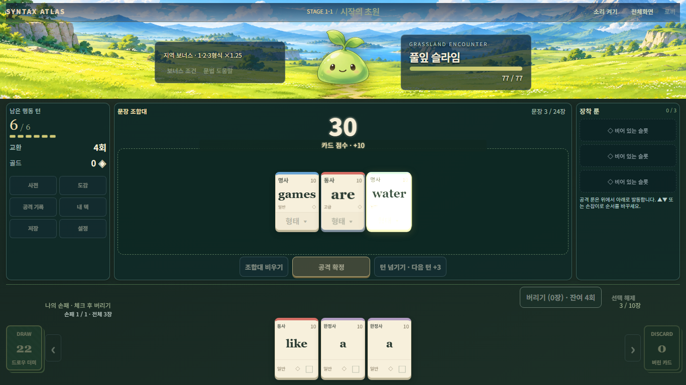
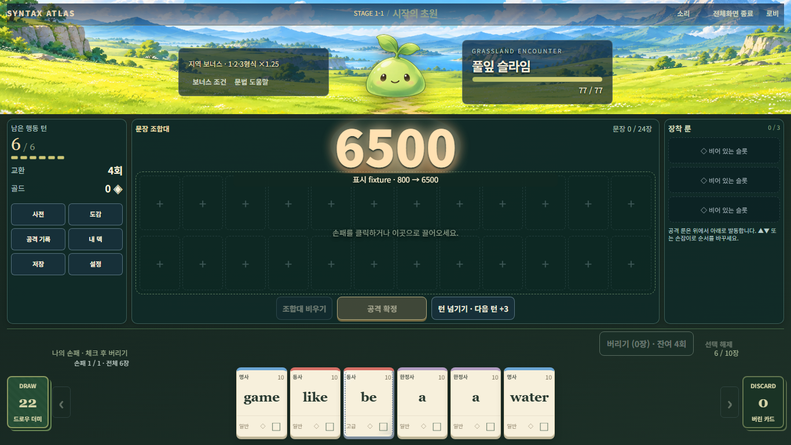
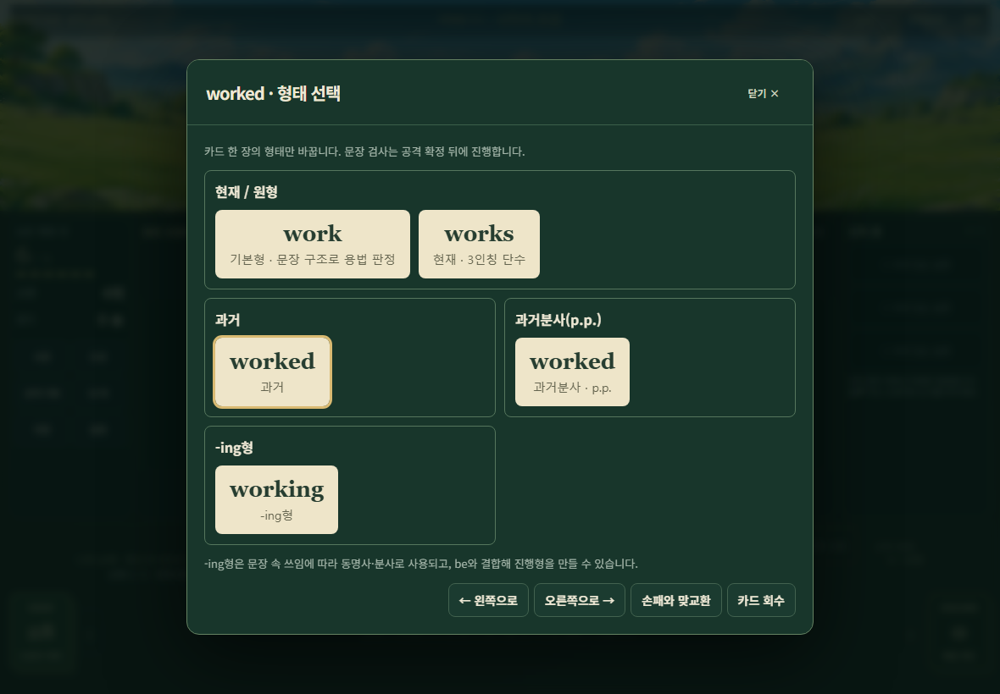
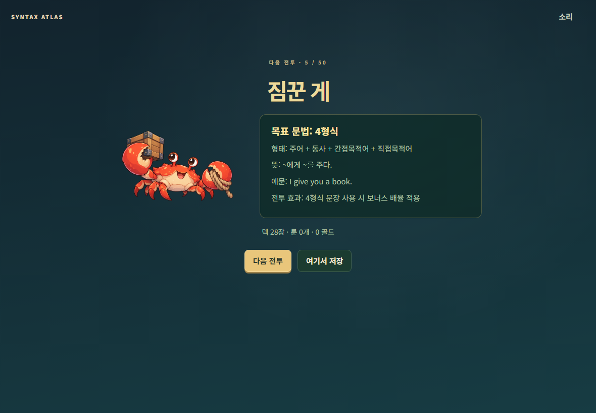

# 0.12.0 학습 덱·문법·점수 오버레이 검증

기준: `e0c68d83985605aa1ed950889e87da2df9c45aec` (작업 시작 최신 origin/main). 브랜치: `codex/v0.12.0-learning-score-overlay`. 시작 작업 트리는 깨끗했고 기존 브랜치·ZIP을 보존했다. 원본 에셋, 오디오, HP·턴·룬 수치와 의존성 버전은 변경하지 않았다. package/lockfile의 앱 버전만 0.12.0으로 변경했다.

## 구현과 언어 검토

- 새 원정만 언어/덱 정책 0.12.0을 사용한다. 파서 capability 기반은 0.10, 수치·룬·보스 정책은 0.11에서 상속한다. 명시적 버전 허용 목록과 최종 지역/저장 검증을 함께 확장했다. 이전 원정 덱·상품·RNG·완료 경계는 마이그레이션하지 않는다.
- 초급/기본/심화의 고정 동사는 명세 표대로 기존 8개 동사 슬롯을 교체한다. 품사 합계28, be2/have1/make1, go/run1. 첫 손패 보장은 하지 않는다. FREE는 종전 0.8.1 생성 분포와 RNG 표본을 그대로 보존한다.
- 긍정 주절 명령문은 원형과 실제 보어를 검사한다. 암시 you는 물리 카드/주어 룬/시제 과제 근거가 아니다. 문형·룬·지역·장막은 기존 구조 증거로 처리한다.
- 준비 화면은 다음 encounter의 idle/고정 안내를 읽으며 RNG·지급·셔플을 호출하지 않는다. 지역 입장 풍경은 유지한다.
- 형태 팝업/버리기 확정만 확대했다. 같은 표면형의 겸용 용법은 한 버튼, 과거/p.p.는 별도 버튼이다.
- 점수 overlay는 실제 ScoreEvent.after만 표시한다. 11개 경계의 크기 유지·한 번 도약·감점 축소·공격 초기화·cleanup을 분리했다. 입력은 통과하고 fullscreen host로 이동한다. 기존 근거 카드/돌진/소리/몬스터 view 수명을 유지한다.

| 어휘 | 검토한 용법 | 형태/획득 기준 |
|---|---|---|
| watch / notice | SVO, O+원형/-ing 지각 | watches/notices, watched/noticed, watching/noticing; 과거와 p.p. 별도ID. see의 등급·획득 정책 |
| allow | SVO, O+to | allows/allowed/allowing; want의 정책. O+원형은 미허용 |
| try | SVO, to(노력), -ing(방법 시험) | tries/tried/trying; like의 정책 |
| remember | SVO, to(해야 할 일), -ing(이미 한 일) | remembers/remembered/remembering; like의 정책 |
| plan | 가산 명사 + SVO/to 동사 | 기존 명사 기본ID/색/등급. plans/planned/planning |
| work | 동사 + 일·작업의 불가산 명사 | 기존 동사 ID/색. 작품의 가산 용법은 범위 밖 |
| change | 동사 + 가산/불가산 변화 | 기존 동사 ID/색. changes는 구조로 판정 |

see/need/want/like의 기존 검토 프레임을 유지했다. 새 어휘도 실제 카드 snapshot·사전·도감의 구조 증거로 연결하며, 문장 정답 목록을 production에서 사용하지 않는다. 단어별 간단한 의미 차이는 고정 검수 데이터로 저장한다.

## 실제 검사

실행 환경: 기존 로컬 Node24.19.0/npm11.17.0, Playwright1.51.1 Chromium. 최종 결과는 다음과 같다. 모두 종료 코드 **0**, skip 없음.

| 실제 명령 | 결과 |
|---|---|
| `npm.cmd test` | **PASS 1845/1845**, 약282초 |
| `npm.cmd run validate:data` | **PASS 3303개**, 155lexemes/402forms |
| `npm.cmd run build` | **PASS**, Vite137모듈. 500kB 초과 번들 경고는 남음 |
| `node tests/learning012-browser.mjs` | **PASS 9묶음**, Chromium 개발 서버에서 실제 카드/명령/연출 |
| `node tests/gamefeel-browser.mjs` | **PASS 10묶음**, 기존 DOM/FX/감점/소리/전체화면 검사 재사용 |
| 로컬 `extra-check.mjs` | **PASS 4묶음**, 겸용 실제소모/SVOO토파즈·지역·장막/고정예문39/신규보상후보 |

[명령 시각·종료 코드·로그 해시·브라우저 실측](evidence-v0.12/summary.json). 원본 로그는 ignored 실행 폴더에 보존한다. 브라우저는 개발 서버에서 실행했으며 production은 빌드까지 확인했다. production UI 전체 완주는 **NOT RUN**.

| 묶음 | 결과/근거 |
|---|---|
| **PASS** T1 새 덱 | 3모드×3seed, FREE1표본. 품사/동사/평서문 경로/재현성 |
| **PASS** T2 기본 어휘 | 실제 카드·선택형 기반 양성/음성 및 5형태 |
| **PASS** T3 겸용 | 문장 구조 역할, 동형 선택ID, 가산성, 외부형태 거부 |
| **PASS** T4 명령문 | SV/SVC/SVO/SVOO/SVOC, 원형 오류·평서문 오류 보존 |
| **PASS** T5 연동 | 장막/문형/시제 근거, 후반 보스 receipt 재해석 |
| **PASS** T6 저장·진행 | 구버전 저장/튜토리얼, 여섯 상점, 지정 덱47→50 및 중복 정산 거부 |
| **PASS** T7 준비·조작 | 다음 일반/보스 안내, 형태창, 실제 버리기 |
| **PASS** T8 점수 | 모든 경계 전후/도약/축소/재돌파/새 공격, 고점은 표시 fixture |
| **PASS** T9 실제 연출 | 시작 손패로 실제 공격 + 지정 실제 카드 복합/감점 공격 |
| **PASS** T10 환경 | PC1366×768 창/실제 fullscreen, 태블릿1180×820 에뮬레이션 |

## 검사 변경과 발견 후 수정

첫 전체 실행은 1838/1843 PASS, 5 FAIL이었다. 명령문 후보 우선순위가 기존 현재완료 절 연결에도 적용되는 파서 회귀를 명령문 후보에만 한정했고, 기존 평서문 문형/완료/절 연결 근거 동일성 회귀를 추가했다. 이후 #47에서 최종 지역을 허용하지 않던 구체 버전 검사도 0.12로 확장했다.

구버전 fixture는 최신 NEW_RUN에 버전 문자열만 바꾸면 신규 동사가 섞이므로 0.11 생성기를 명시해 원래 덱/RNG를 유지하도록 고쳤다. 구버전 assertions는 유지했다. p.p. 표시 기대값만 명세의 `과거분사 · p.p.`로 바꾸었다. 브라우저 숫자/라벨 selector는 실제 overlay로 옮기고 기존 검사를 유지했다.

`I try you to run`/`I remember you to run`은 목적어+to 목적격보어로 인정하지 않는다. 기존 엔진이 별도의 목적 부사구로 분석할 수 있으므로 전체 INVALID를 강제하지 않고 SVOC/OBJECT_COMPLEMENT가 아님을 검사한다. 문맥적 자연스러움 전체를 보장하는 범용 NLP는 아니다.

추가 저장 검사 작성 중 누락된 과거 완료/상점 이력 때문에 실패한 지정 fixture는 기존 helper로 구성해 검증했다. 이 실패를 실제 게임 저장 버그로 보고하지 않는다. 원본/초기 실패/최종 실행 로그는 `.local-validation/v012` 및 `.local-validation/v0101/v012-*`에 별도로 보존했고 과거 Work 고정 출력은 복원했다.

## 대표 화면과 실측

- PC1366×768과 fullscreen: 숫자 중심 오차 최대0.008 CSS px 미만. 6500 fixture의 정착 글자 크기86.48px, pointer-events:none. 모든 실제 이벤트 after와 표시 정수가 일치했다.
- 태블릿1180×820: 선택 외곽선 포함 손패 실제 하단 여유는 기존 Game Feel 검사에서 **14 CSS px**이었다. 형태 팝업740px 폭, viewport 내부; 빈 손패/공격 중 외곽 구역은 고정했다.
- 동일 지역 BGM 소스·위치 유지, 설정 gain0.8×37%=0.296, 지역 전환3초 유예/1.5초 fade를 실제 buffer 상태로 확인했다. 사람의 실제 청취를 뜻하지 않는다.

## 한계

50전투 자연 완주·대량seed·전 브라우저·실제 패드/카카오톡 청취·공용 랭킹 연결: NOT RUN. 최종3전투는 지정 덱/실제 정산 검사이며 자연 승률 근거가 아니다. 6500/10000 시각 검사는 표시 fixture이며 자연 고점이 아니다. 불꽃 색·세기와 작은 간격 취향은 사용자 플레이 후 폴리싱한다. main 병합·Pages 변경·공개 배포를 수행하지 않는다.
