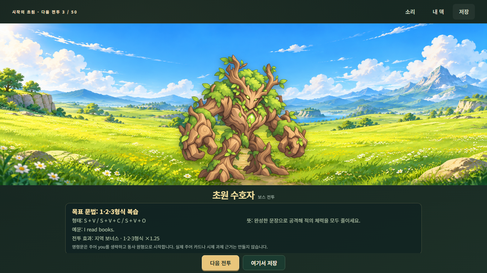
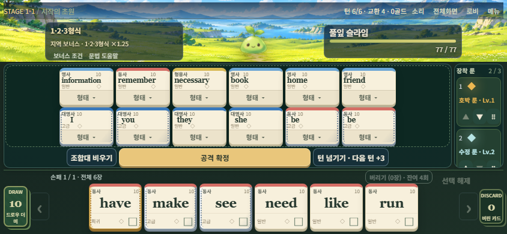
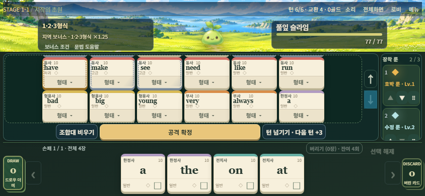

# 0.13.0 파노라마·모바일 구현 및 실제 검사

기준: `aa28555b51a37daf9245a1d2e9b49f2eb5cedeae`(시작 시 최신 origin/main, PR #30). 작업 브랜치: `codex/v0.13.0-panorama-mobile`. 시작 작업 트리는 깨끗했으며 이전 브랜치·원본 ZIP은 보존했다. 앱/패키지 표시만 **0.13.0**, 원정/언어/점수/저장 계약은 **0.12.1**이다.

## 변경

- BETWEEN_BATTLES에 기존 Stage1/2 combat 원본 전체를 비율 보존 표시하고, 실제 alpha bounds로 일반/보스 몸체와 접지를 맞춘다. 기존 안내·기믹 상세·자원·진행/저장 기능을 보존했다. 실제 원본은 명세의 예시와 달리 **2172×724(3:1)**이다.
- 실제 터치 입력과 viewport로 휴대폰을 구분하고 전 화면 가로 배치·회전 안내 탈출·메뉴·룬 레일·손패 페이지를 연결했다. 넓은 PC/패드의 기존3열은 유지하며1024px는3열 폭만 맞춘다.
- 조합 순서/카드 ID/24장 한도는 그대로다. 긴 `information/necessary/remember`를 포함한667/844/932px에서는 각12장 묶음을 **6×2**로 표시한다. 24장은 실제 두 묶음이며 내부 스크롤/↑↓로13~24장까지 조작한다. 형태창에서 전체 표기를 확인할 수 있다.
- 골렘의 실제 부위 노드를 휴대폰 HP 내부 스크롤에 놓고 PC에서는 기존 둘째 행으로 복귀시킨다. 카드 편집·회전 후 중복 노드나 상태 정산을 만들지 않는다.

수정 범위: `src/main.js`, `src/appVersion.js`, `src/ui/{combat,progression,boardLayout,viewport,orientation,deviceLayout,panoramaPreview}.js`, 신규 표시 CSS4개, 관련 작은 검사/브라우저 검사, 패키지 표시·인계 문서. **src/game·engine·data·services, public 에셋/BGM, .github 워크플로에는 diff가 없다.** lockfile은 루트 버전2곳만 변경했으며 의존성/무결성은 유지했다. 28장·50전투·보스·HP·경제·RNG·구저장 규칙을 변경하지 않았다.

## 실행 결과

기존 로컬 도구 재사용: Node24.19.0 / npm11.17.0 / Playwright1.51.1 / Chromium134.0.6998.35. 새 설치·전역 PATH 변경 없음. [기계 판독용 실행 요약/로그 해시](panorama-mobile-0.13/results.json).

| 실제 명령 | 종료 | 결과 |
|---|---:|---|
| `npm.cmd test` | 0 | **1930 PASS, FAIL0, skip0** |
| `npm.cmd run build` | 0 | production 생성. 기존 번들 크기 경고(JS693.16kB) |
| `node tests/gamefeel-browser.mjs` | 0 | 11묶음: PC/전체화면/태블릿, DOM 수명, 정상·2배속·감점·방어, 실제 BGM 순차 전환 |
| `node tests/device-stability-browser.mjs` | 0 | 5묶음: 탭/드래그/멀티터치/모달/슬라이더/저장/복귀 |
| 위 명령 `--audio` | 0 | 1묶음: trusted 모의 터치·suspended 재개·음소거/0 |
| 위 명령 `--production` | 0 | 2묶음: 실제 `/grammardealer/` JS/CSS/자산, 새로고침·실습 스킵·저장/로드, 자산 실패 fallback |
| `node tests/panorama-mobile-browser.mjs --section=<아래9개>` | 각각0 | 9묶음 독립 실행 PASS |

집중 섹션: `actual-flow`, `panorama`, `missing-panorama`, `board-layout`, `card-rune-input`, `other-views`, `focused-modal-captures`, `mobile-attack`, `saved-preparation`. 캡처 섹션 외에는 `--no-captures`로 실행했다. 파노라마15뷰, 보드6해상도/24배치 사례는 이9묶음의 내부 사례이지 별도의 자연 원정 통과 수가 아니다. 변경 없는 전체 검사를 반복한 것이 아니라 발견된 골렘/복귀 결함을 고친 뒤 최종 단위와 영향받은 브라우저 경로를 재실행했다.

실제 새 원정의 시작·카드 탭·저장/로드·`I go` 공격은 일반 앱 경로다. 지정 등록 카드 공격/보상으로 만든 정상 BETWEEN_BATTLES 상태도 실제 저장→앱 재시작→UI 로드 후 RunState/RNG·미리보기 좌표가 같고 다음 전투1회로 이어짐을 확인했다. 최대 카드/보스/상점/보상/결과 검사는 **등록 카드와 Controller를 쓰는 지정 상태**이며 자연 획득·완주를 주장하지 않는다. 마지막 모바일 공격은 resize 중 실제 복사본의 CHARGE/LUNGE, **공격1·피격1**, 표시층 cleanup을 확인했다.

기존 테스트 기대값 변경은 앱 버전0.13.0 및 과거 ‘좁은 화면 가로 스크롤’ 기대를 이번 명세의 ‘휴대폰 viewport 맞춤’으로 바꾼 두 항목뿐이다. 테스트 삭제/skip/허용오차 완화는 하지 않았다. 과거 고정 증거 `timing.json`/`reward-distribution.json`은 실행 후 별도 보관하고 원래 파일을 복원했다.

## 인수 조건 근거

PASS는 아래 실제 검사 범위를 뜻한다. 실기기나 자연 원정까지 확장 해석하지 않는다.

| 조건 | 상태 | 근거/범위 |
|---|---|---|
| A01 | PASS | 실제 Stage1/2 원본,15뷰에서 비율/양끝/폭 |
| A02 | PASS | 기존 지역 테마·대표 캡처, 다른 지역 대체 없음 |
| A03 | PASS | alpha 몸체 중심/접지 단위·브라우저 좌표 |
| A04 | PASS | 일반2× 목표·안전 상한·크라켄 전체 bounds |
| A05 | PASS | 작은 가로 하단 내부 터치 스크롤·목표/예문/자원 접근 |
| A06 | PASS | 다음/저장1회 callback 및 실제 NEXT_BATTLE |
| A07 | PASS | 지정 다음 전투 enemyId 일치, 실제 시작 공격 |
| A08 | PASS | Stage3 미등록 이미지 fallback |
| A09 | PASS | 실제 combat/idle 요청 차단 후 정보/저장 작동 |
| A10 | PASS | PC 기존 DOM/배경·BGM 검사, 입장/보상 로직 보존 |
| A11 | PASS | 15뷰 교체·계속 조작·cleanup 단위/코드 확인. heap 계측 NOT RUN |
| A12 | PASS | 실제 LocalStore 슬롯2 저장→앱 재시작→UI 불러오기: RunState/RNG·파노라마/몸체 좌표 동일, 다음 전투1회 |
| B01 | PASS | 실제 로비/입장/전투, 지정 상점/선택/보상/결과/모달 |
| B02 | PASS | 회전 안내/탈출·거절 fallback, PC 오판정 방지 |
| B03 | PASS | PC/넓은 패드 기존3열·카드 경로 유지,1024폭 맞춤 |
| B04 | PASS | 중앙 몸체/좌우 정보·핵심 버튼 경계 확인 |
| B05 | PASS | 실제 자원 HUD·소리·메뉴·기존 진입 경로 |
| B06 | PASS | 1/5/8/11/12장 배치·작은 기하 검사 |
| B07 | PASS | 실제13/24장 ID·순서·12+12, 마지막 형태 조작 |
| B08 | PASS | 667/844/932px 긴 단어6×2 fallback 명시 |
| B09 | PASS | 긴 영어 단어/형태 메뉴 전체 표기 |
| B10 | PASS | 탭·드래그·순서·스왑·회수·형태 선택 |
| B11 | PASS | 지정 실제 룬2개 순서/상세/이동 및 기존 드래그 검사 |
| B12 | PASS | 실제 손패 부분집합·페이지 전환 상태 불변 |
| B13 | PASS | 서로 다른 페이지2장 선택, 교환1/턴0·정확한 discard |
| B14 | PASS | 실제 submit/잠금/완료 및 기존 명령 조건 유지 |
| B15 | PASS | 실제 모바일 공격/resize, 복사본·점수·피격·정산1회 |
| B16 | PASS | 골렘/빙결핵/이중 인장 표시·스크롤/공략 접근, 기존 규칙 단위 |
| B17 | PASS | 상점 페이지·연마/제거 취소·보상3택·저장·사전/도감 |
| B18 | PASS | 자동화 멀티터치/취소/스크롤/슬라이더. 물리 핀치·더블탭 NOT RUN |
| B19 | PASS | 실제 AudioContext/버퍼 전환·음량·재개. 실기기 청취 NOT RUN |
| B20 | PASS | 667×375/844×390/932×430/1024×768/1366×768/1920×1080 |
| B21 | PASS | 상점·보상 회전 상태 보존, PC→폰 카드 조작, 공격 resize·trusted fullscreen |
| B22 | NOT RUN | 동일0.12.1 저장 계약의 정확한 roundtrip·공격은 PASS. 과거0.12.2에서 내보낸 별도 사용자 저장 파일은 미실행 |

## 대표 화면과 측정

844×390의 손패는 **88×76px**, 실제 하단382px로 **8px** 여유다(선택 외곽 포함 측정). PC 전체화면과 휴대폰 캡처는 각각 별도 브라우저 컨텍스트다. 파노라마를 자르지 않아 휴대폰 준비 안내의 표시 높이는 약39px이며 내부 스크롤로 읽는다.

## 발견·해결과 한계

- 실제 실패: 기존274px 중간행이 새 모바일 행보다 커 버튼/손패가 겹침 → 명시적 행 높이/열 수정. 배경 음수 inset 때문에 viewport가850px로 팽창 → 모바일 padding에 맞춘 inset. 골렘의 둘째 행 넘침 → HP 내부 스크롤/명시적 grid row. PC 최소폭1160px가 휴대폰 판정을 고착 → 실제 root client viewport 사용. 수정 후 해당 경로를 재검사했다.
- 테스트 도구 준비 문제: 캐시된 이미지에 abort를 적용하거나 hash-only 이동으로 새 문서가 열리지 않은 경우는 fresh document에서 재현했다. 새 저장 검사 fixture의 LocalStore registry 누락은 production과 같은 생성자로 고친 뒤 재실행했다. 초기 미로딩 캡처는 최종 대표 화면으로 쓰지 않았다.
- 준비 안내의 버튼 근처에서 시작한 모의 터치는 저장 버튼을 대상으로 잡았다. 실제 왼쪽 안내 영역에서 스와이프하면 scrollTop104까지 진행하며 내용에 접근한다. 원인을 전체화면/compositor 결함으로 확정하지 않는다. 작은 정보창의 터치 여유는 사용자 피드백 폴리싱 항목이다.
- 실기기 iOS/Android/카카오의 확대·회전·청취, heap 계측, 자연50전투, 전체 옛 브라우저 묶음, 로컬 `validate:data`는 **NOT RUN**이다. 이번 변경은 언어/데이터를 수정하지 않았다. Stage3 이후 미등록 이미지/BGM은 기존 fallback 정책을 유지한다.
- 초기 실패/원본 로그는 `.local-validation/v013/`와 `.local-validation/v0101/v013-*/`에 보존하고 공개 보고서에는 상대 경로·최종 요약·4캡처만 포함했다. 외부 계정/서버/비용·의존성 설치 없음.

main 병합·Pages 설정 변경·공개 배포는 수행하지 않는다. 별도 브랜치의 소스/보고서/검사를 PR로 인계한다.
