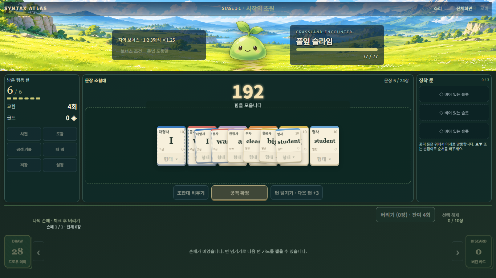
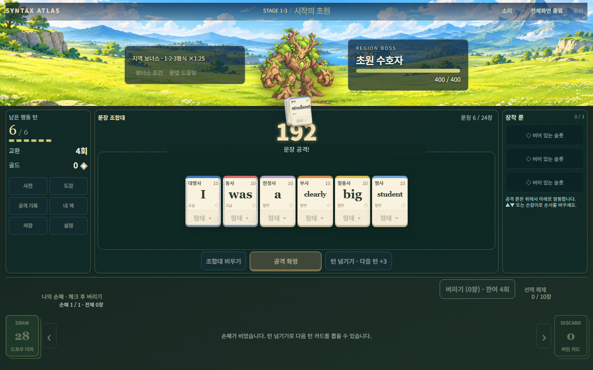
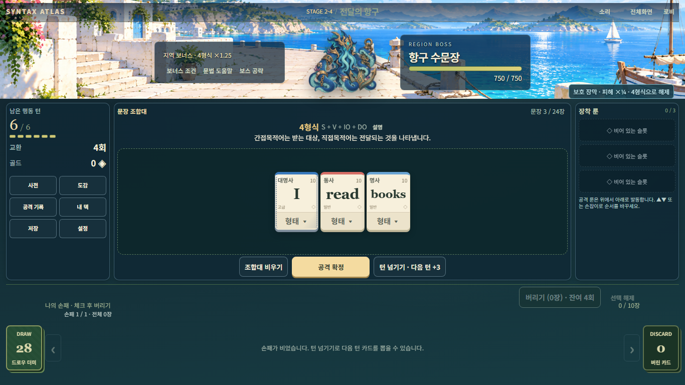
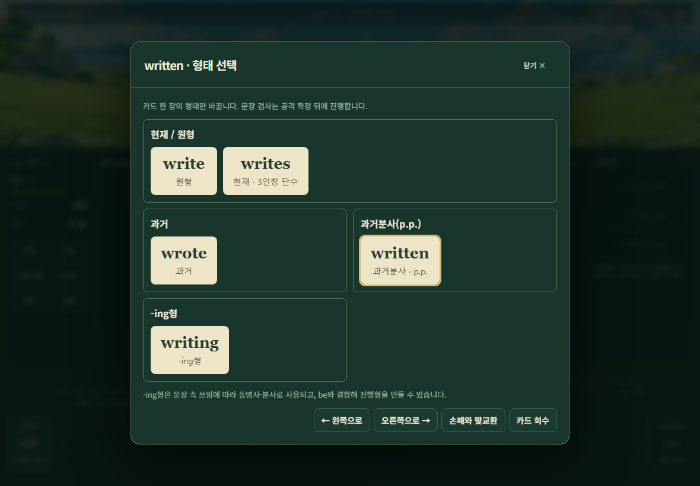

# 0.12.1 통합 폴리싱 — 실제 구현·검사

작업 기준은 최신 `origin/main@61f02494888e8358161d53aba13631f0af143f71`이다. 시작 작업 트리는 clean이었으며 이전 브랜치를 보존하고 `codex/v0.12.1-integrated-polish`에서 진행했다. 원본 ZIP을 소스로 덮지 않았다. 실행 환경은 기존 Node 24.19.0 / npm 11.17.0 / Playwright 1.51.1 Chromium / Windows다.

## 변경

- 새 0.12.1 언어·공급 정책만 smile, 확정 8개 어휘, of를 추가한다. look/room은 새 공급에서 제외하며 game과 과거 정의·저장·기록은 유지한다. write/wrote/written, 명사 복수, 동사 문형·완료·수동·내용절과 사전 설명을 연결했다. 밴드는 STANDARD/ADVANCED, 신규 카드 희귀도는 COMMON으로 구분한다.
- hard/fast/well, answer/watch/show는 기존 물리 카드에 역할을 연결한다. too의 정도/첨가, try/remember의 기존 to/-ing, notice/remember/discover의 명시적 that 목적어절을 검사한다. 형용사별 TO/THAT/FOR_TO/OF_TO 허용표와 목적격·to 뒤 원형 검사를 사용한다. for 의미상 주어와 of 평가 대상의 실제 카드 근거를 구분하며 기존 콤보·룬·Stage9 회복 저지·최종전 과제로 전달한다.
- 형태 팝업 원형 라벨을 `원형`으로 정리한다. p.p.·큰 버튼·폰트·간격은 유지한다.
- 공격 중 `atlas:viewport`가 제출 표시자료를 버리던 경로를 수정한다. 같은 크기 이벤트는 유지하고 실제 resize/fullscreen에서는 원래 카드 복사본·현재 연출 시각을 재배치한다. 게임 정산은 기존 Controller에서 한 번만 수행한다.
- 지역 BGM은 **약 1.5초 fade-out → 실제 source 종료 → 오디오 시계 기준 1초 무음 → 약 1.5초 fade-in**으로 교체했다. 기존 3초 대기/크로스페이드를 겹치지 않는다. 같은 곡·빠른 전투 진입·이전 지역 상점·취소·늦은 로드·실패 재시도·suspended/mute를 처리한다. 기준 gain 0.8과 SFX 설정은 유지한다.
- 기존 PNG의 몸체 경계로 두 보스의 2배 목표 배율과 고정 무대 안전 상한을 계산한다. idle/hit은 동일 접지·배율이며 확대된 실제 몸체의 타격점을 사용한다. 일반 몬스터 배율·원본 에셋·CSS는 바꾸지 않았다.

`POLISH0121_VERSIONS`와 기존 버전 허용 목록에 0.12.1을 연결했다. 여러 파일의 한 줄 변경은 50전투·후반 문법/룬·보스 receipt·저장 검증이 이전 경계로 퇴행하지 않도록 하는 연결이다. 기존 버전은 자동 승격하지 않는다. 28장/품사 배분/고정 동사8장, FREE의 기존 무작위 동사 후보, 튜토리얼 덱 복원, HP·턴·점수·룬·상점·경제는 보존한다. package/lockfile은 앱 버전만 변경했으며 의존성은 그대로다.

## 실행 결과

| 실제 명령 | 결과 | 근거·범위 |
|---|---|---|
| `npm.cmd test` | PASS, 종료 0 | 최종 production 소스에서 1,911 tests, fail/skip 0. `v0121-final-unit-r3` |
| `node --test tests/finale-controller.test.js` | PASS, 종료 0 | 11 tests. 0.12.1 지정 덱의 47→마지막 상점→48/49/50 경계를 별도 확인했으며 위 최종 전체 검사에도 포함 |
| `npm.cmd run validate:data` | PASS, 종료 0 | 3,652 checks; 171 lexemes / 457 forms / 21 frames; `v0121-final-data` |
| `npm.cmd run build` | PASS, 종료 0 | Vite 138 modules. JS 682.77 kB, gzip 207.97 kB. 기존 500 kB chunk 경고 있음; `v0121-final-build-r3` |
| `node tests/gamefeel-browser.mjs` | PASS, 종료 0 | localhost 개발 서버, Chromium 11묶음; `v0121-final-browser-r4` |

명령·종료코드·로그 해시·실측 요약은 [evidence/summary.json](evidence-v0.12.1/summary.json)에 기록했다. 원본 로그와 중간 실패·캡처는 git 제외 경로 `.local-validation/v0101/v0121-*`, `.local-validation/v0121/`에 보존한다. 고정 출력의 옛 timing/reward-distribution 증거는 이번 결과를 별도 보관한 뒤 복원했다.

기존 0.12 테스트는 역사 계약용 Controller에 고정했다. BGM의 옛 3초 유지·소스 중첩 기대값만 새 순차 전환 계약에 맞춰 변경했다. 문법 assertion 삭제/skip/허용오차 완화는 하지 않았다. 첫 손패 폼 검사는 특정 단어를 가정하는 대신 실제 다중 형태 카드로 선택한다.

## 명세 묶음별 근거

| 묶음 | 결과 | 실제 확인 |
|---|---|---|
| A 기준·정책 | PASS | 위 기준 SHA·별도 브랜치·기존 버전 유지 |
| B 신규 공급 | PASS | 신규 9개/of와 활용형·밴드·희귀도·보상 후보, look/room 제외, of 해금 후 후보 |
| C 덱·저장 | PASS | 4모드×3seed 28장/고정 동사8장; 구 look/room 저장 재개·실제 제출·로드; 튜토리얼 skip 덱 복원; 전체 기존 저장 회귀 |
| D 겸용·too | PASS | 실물 카드 snapshot 역할·고유 물리 ID·기본점수 한 번; 형용사 well에 부사 효과 없음 |
| E 동사 보어 | PASS | L01–L60 정상 사례와 E01–E14 경계 검사. 실제 등록 형태 기반이며 production 정답 문자열 표 없음 |
| F 가주어 | PASS | 형용사별 제한, 목적격/명사구, for/of 구분, 기존 룬/지역/보스 조건 근거 |
| G 형태·기존 UI | PASS | written의 원형/p.p. 팝업, 준비 idle, 카드 이동/회수/형태 변경 시 같은 상단 DOM·대기 애니메이션 |
| H 공격 | PASS | 지정한 등록 카드로 정상3회+감점1회. 1배/2배, PC 창/실제 fullscreen API 전환, CHARGE 중 resize; 복사본 이동 >50px·IMPACT 1회·중복 FINISH 불변 |
| I 보스 | PASS, 안전 제한 적용 | 두 보스 idle/hit 공통 경계·패널 비침범·실제 보이는 이미지·몸체 타격점. 아래 실측 참조 |
| J BGM | PASS, 청취 제외 | 실제 파일 디코딩/WebAudio source·시계 검사 및 mock clock 취소/중단/오류 재시도. 겹치는 source 없음 |
| K 필수 검사 | PASS | 위 실제 명령 결과 |
| L 실기기·배포 | NOT RUN | 패드 실기기 청취/카카오 인앱 fullscreen/전 기기 순회/자연50전투/production UI 완주. main 병합·Pages 변경·공개 배포 안 함 |

L/E 사례는 첨부 기대자료이며 위 실행 결과와 구분한다. 테스트 문자열 `writed`는 등록 형태가 아니므로 정상 실제 카드 선택으로 만들지 않고 입력 경계에서 거부한다. 이 검사는 영어 전체를 지원한다는 뜻이 아니다. well은 건강 의미의 be/feel 보어, 신규 내용절은 명시적 that 범위이며 like 전치사·임의 추가 어휘는 넣지 않았다.

## 재현·실측과 남은 제한

- 수정 전 같은 정상 문장에서 viewport 이벤트가 없으면 CHARGE/LUNGE 복사본 관측이 각각 11프레임, 이벤트를 제출 직후 보내면 각각 0프레임이었다. 원인은 확인된 snapshot 폐기 경로이며 수정 후 두 위상과 실제 이동을 확인했다. 피해·턴을 연출 코드에서 재계산하지 않는다.
- 마지막 코드 검토에서 resize 후 pause/resume 시 취소된 이전 복사본 애니메이션까지 재생하는 경계를 추가 재현했다(카드당 2개). 재배치 시 취소한 연출을 재개 목록에서도 제거한 뒤 카드당 1개와 단일 IMPACT/정산을 검증했다. 중간 FAIL 로그를 보존하며 최종 필수검사/빌드/브라우저를 이 수정본에서 다시 실행했다.
- BGM 실제 종료/무음/새 시작 시각은 summary의 오디오 시계 값이다. 약 1.5초 후 이전 source가 없어지고 약 1.02초 무음 뒤 새 source가 시작했다. 최대 BGM source 1개, 사용자 37% 설정에서 실효 gain 0.296(0.8×0.37)이었다. 기기 스피커로 들었다고 주장하지 않는다.
- 태블릿 1180×820의 선택 외곽까지 포함한 손패 하단 최소 여유 **14 CSS px**. 빈 손패에서도 구역 경계가 같다. 기존 카드 크기/폰트/품사색/12×2 배치를 변경하지 않았다.
- PC 1366×768의 고정 상단 무대는 145px여서 두 보스 몸체 높이는 약 **126px / 125px**로 안전 제한된다. 1280×800의 수호자는 약 **158px**였다. 모든 화면에서 실제 2배라고 보고하지 않는다. 무대를 키우거나 패널을 밀지 않는다.
- 첫 보스 캡처에는 이미지 표시 준비 전 장면이 잡혔다. decode/paint 대기와 조상 opacity/visibility 검사를 추가한 뒤 실제 표시를 확인했다. 게임의 지속적인 이미지 소실로는 재현되지 않았으며 이를 이유로 UI 코드를 바꾸지 않았다. 개발 중 HMR 모듈 중복으로 발생한 오디오 검사 실패는 깨끗한 개발 서버 재시작 후 해소했다.

## 대표 화면

아래 공격은 지정한 등록 카드와 실제 문법/점수/공격 경로로 실행했다. 자연 원정 획득·완주 증거가 아니다.

검토 순서: 새 원정의 덱/사전 → 정상 문장 확정 중 창·전체화면 전환 → write의 원형/wrote/written → 보스 표시 → 보상 후 상점의 같은 곡과 다음 지역 입장 시 순차 BGM. 구 원정은 원래 언어/공급 정책으로 이어진다. 작은 색감·크기 취향은 사용자 플레이 피드백으로 남긴다.
