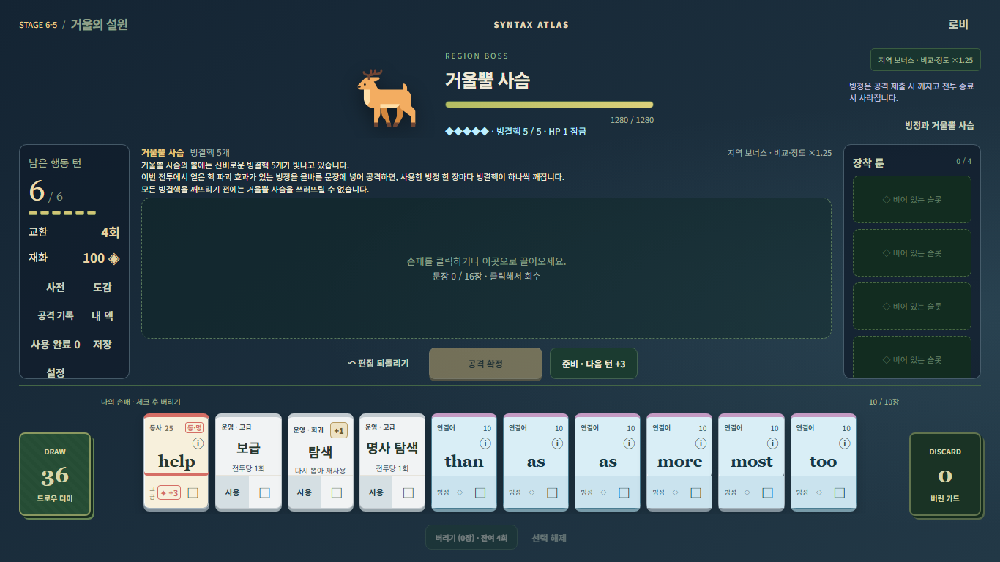
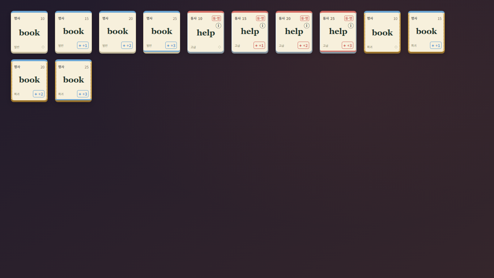
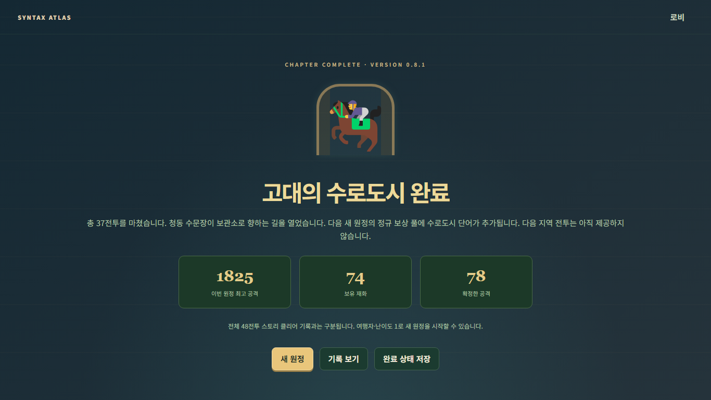

# Syntax Atlas 0.8.1 패치 검증

기준은 작업 시작에 fetch한 origin/main `587fa1b681c5fcd0ac8090111e7e9850dac95f08`이다. 시작 checkout은 clean이었으며 `codex/v0.8.1-grammar-help-ui-polish`에서 작업했다. 이전 ZIP의 코드나 배포 번들로 소스를 교체하지 않았다. ZIP/외부 명세는 동일 SHA-256 `3fb9cf91a708cc7f239f9b145bb6567b00e708cda1cd5679b7bb6c907f1188e7`이다.

검사 루트는 `grammardealer/`. 기존 Node 24.19.0/npm 11.17.0/Git 2.51.0.windows.2/Vite 8.3.2/Playwright 1.51.1을 재사용했다. 의존성 설치·업그레이드와 시스템 PATH 변경은 없다. package/lockfile의 루트 버전만 0.8.1로 바꿨다.

## 구현

- 생략 목적격 관계절을 인칭대명사에 붙여 비정상 전체 문장을 성립시킨 경로를 교정했다. 정상 명사 선행사와 명시 관계사, 별개 주격/목적격 관계절은 유지한다. 표면 단어나 신고 문자열을 예외 처리하지 않았다.
- help의 기존 동사 어휘와 별도 MASS 명사 어휘를 같은 고급 카드에 연결했다. 기본형 help만 명사 ‘도움’이며 동사 활용·기존 동명사/분사는 유지한다. 주 품사는 동사로 고정하고 탐색 대상도 기존 주 품사를 따른다. 제출 후 실제 선택된 품사를 역할 표시와 공격 기록에 전달한다. 채점은 같은 확정 분석을 사용하며 물리 사본별 기본점수는 한 번만 더한다.
- 새 생성기 0.8.1은 기존 28장 구성과 have 고정 슬롯을 유지하면서 help를 제외한다. 새 상점 후보에서도 제외하며 고급 전투 보상에서는 한 후보/한 사본으로 취급한다. 이미 공개된 상품·보상 및 보유 help는 삭제하지 않는다.
- 운영/빙정/검은 먼지의 긴 설명을 클릭·터치 상세로 이동했다. +1 보급·직접 탐색에는 ‘다시 뽑아 재사용’을 표시한다. ‘전투당 1회’를 모든 운영 카드에 일괄 표시하면 0.6.1 확정 재사용 규칙에 어긋나므로 이 두 경우의 실제 규칙을 우선했다.
- 기존 상아색과 품사색을 유지하며 고급 은빛/희귀 금빛 세공 테두리, 품사색 +1~+3 배지와 +3 안쪽 장식을 추가했다. help의 우측 ‘동·명’ 배지는 판정 전에 바뀌지 않는다.
- Stage1~8 37개 고정 안내와 실제 지역 배율을 연결했다. 사막 명사적 to부정사, 명사 수식/목적 용법, 동명사, 5형식을 구분한다. 공격 중 기존 피드백을 표시하고 편집 복귀 때 안내를 복원한다. 상시 입장 지급 문구는 실제 신규 지급 시 한 번의 알림으로 옮겼다.
- 보스 기본 설명을 특징/행동/처치 조건으로 줄이고 기존 상세 예외는 유지한다. 빙결핵 5개, 실제 대상 사본, 양수 피해, 영구/지원 제외, HP1 보호와 마지막 핵 공격부터 격파 가능 조건은 바꾸지 않았다.

## 저장과 수치 경계

새 원정/save는 0.8.1, 생성기는 0.8.1이며 언어/문법/점수 정책의 0.8 계약과 37전투를 재사용한다. 새 분석/이중 인장 영수증에는 grammarPatchVersion 0.8.1을 기록한다. 이전에 이미 정산한 0.8 인장·잿불룡 비늘 해제 영수증은 당시 파서로 재검증하여 저장을 읽되, 새 제출에는 수정된 파서만 사용한다. 기존 잘못된 문장으로 얻은 피해/보상을 다시 정산하지 않는다. 구버전 원정 자체의 버전, RNG, 카드, 상품, 진행 경계는 갱신하지 않는다. 0.7 이하의 원래 언어 DB도 유지한다.

Stage 데이터와 기존 룬 데이터는 수정 전 독립 포착 값과 대조해 동일했다. HP·턴·교환·점수·배수·가격을 변경하지 않았다. 새 시작 후보에서 help가 빠지므로 새 0.8.1 원정의 동일 시드 덱은 0.8과 달라질 수 있다. 이것은 새 획득 정책이며 이미 저장된 덱을 재생성하지 않는다.

## 테스트 변경 이유

- 0.4~0.7 테스트 컨트롤러는 원래 생성기 0.4를 명시하도록 보강했다. 새 current NEW_RUN 뒤 버전 이름만 구버전으로 덮던 테스트가 0.8.1 덱을 사용한 것이 원인이다. 과거 golden·hash·기대값은 변경하지 않았다.
- 도감의 ‘과거/진행/완료’ → ‘과거시제/진행형/완료형’ 세 제목과 로비 0.8.1 배지만 새 명세대로 비교한다. 기존 카탈로그 파일과 나머지 순서/문구 검사는 보존했다.
- QA 후보/운영 정책의 지원 버전 목록에 0.8.1을 추가했다. 숨은 드로우 순서·정답 문자열·카드 생성으로 자연 완주를 보조하지 않는다.
- 새 검사 초안의 `The book I made is good books.`는 의미가 어색해도 문법적 NP 보어 분석이 가능하므로 오류 대조로 부적절했다. 허가되지 않은 여분 동사 `runs`를 붙인 최소 대조로 바로잡았다. 의미 자연스러움을 게임 감점으로 추가하지 않았다.
- 새 브라우저 검사에서 WebKit의 한글 경로 영상 출력 오류는 기존 browserVideo 임시 ASCII 경로를 재사용했다. 영상·스크린샷·assertion을 끄지 않았다.

## 증거 수준

수정 전 실제 npm test 1347 PASS, 데이터 3046 checks PASS, 빌드 PASS를 별도 보존했다. 수정 전 306개 실제 물리 snapshot 결과와 신고 문장/과거 정산 영수증을 독립 포착했다. 이번 모든 재실행은 새 `.local-validation/v081/` 하위 실행 ID로 남기며 과거 Work/0.8 PASS를 이번 결과로 인용하지 않는다.

합성 문장/지정 상태 UI/실제 Controller 원정/실제 production UI 완주를 서로 구분한다. 48개 인수 조건은 별도 표의 현재 실행 증거만 따른다. 브라우저 원시 로그의 개인 절대 경로는 공개 문서에 복사하지 않는다.

추가 저장 경계: 문법 교정 뒤 기존 잿불룡 해제 영수증이 같은 과거 오인정을 포함할 때 로드가 거부될 가능성을 조사했다. 작업 시작 SHA의 src를 별도 ignored 참조 폴더로 읽어 원본 Controller의 지정 Stage7/실제 SUBMIT으로 유효한 구버전 저장을 만들었고, 원본 validator PASS / 교정 중 validator `Invalid ember release receipt`를 실제 확인했다. 이 상태는 개발 중 추가 독립 포착이며 사전 baseline이나 자연 완주가 아니다. 해당 영수증도 저장 당시 parser로 확인하도록 좁게 보완했다. 신규 0.8.1 영수증의 patch marker 삭제는 거부한다.

빙정 설명 이동에 따라 0.6.1 브라우저 회귀는 손패의 긴 문구 대신 상세 창의 전투 한정 안내를 검사한다. 상세를 열어도 상태가 바뀌지 않는 assertion을 추가하고, 대비 검사는 제거된 설명 대신 현재 보이는 빙정 정보 버튼과 운영 헤더를 측정한다. 대비 기준·색상 기대값·7개 상태·레이아웃 검사 수치는 완화하지 않았다.

자동 원정의 첫 37전투 완료를 문장 단위로 감사하는 과정에서 `they that were living environments will know think`가 비정형 절 `living`을 명사 어휘 선행사로 승격해 두 관계절을 만든 것을 확인했다. 초기 Controller 명령 종료는0이지만 이 실행은 최종 올바른 문법 완주 근거에서 제외했다. 명사 역할에 놓인 비정형 **절**과 등록된 명사 **어휘**를 구분하도록 관계절 부착 경로를 추가 교정했다. 일반 동명사, 그 내부의 실제 명사 관계절, 정상 중첩 두 관계절 및 명사 help는 대조 검사로 보존했다. 같은 표면 철자를 일괄 금지하거나 영어 의미의 자연스러움을 감점하지 않았다.

혼합 운영+빙정 손패14/조합16/룬4의1366×768에서는 안내 추가 후 문서 높이784px를 재현했다. 지역 보너스를 학습 제목과 같은 줄에 구분 배치하고, 낮은 화면의 최대 조합 상태에서 안내 외곽·손패 상단 여백을 정리했다. 카드 본문/44px 조작부 크기는 유지하며 기존 가로 손패 스크롤을 사용한다. 1차 재배치의769px 실패도 별도 보존했다.

## 최종 실제 실행

모든 명령은 실제 checkout에서 순차 실행했고, 개발 서버는 `npm.cmd run dev -- --host 127.0.0.1`로 띄웠다. 검사 프로세스에만 기존 Node/PW 경로를 설정했다. production 검사에는 별도 localhost 서버와 임시 브라우저 프로필을 사용했다. 공개 사이트나 사용자 저장을 삭제하지 않았다.

| 명령 / 실행 ID | 결과 | 실제 범위 |
|---|---|---|
| `npm.cmd test` / release-unit-visual | PASS / 0 | 1,382 tests, 실패·skip 0 |
| `npm.cmd run validate:data` / release-data-visual | PASS / 0 | 3,058 checks |
| `npm.cmd run build` / release-build-visual | PASS / 0 | Vite production, 95 modules |
| `npm.cmd run test:browser` / official-browser-release | PASS / 0 | 기존14개 스크립트 전체, 마지막 snow UI까지 완료 |
| `node tests/grammar-polish-browser.mjs` / focused-cross-release | PASS / 0 | Chromium/Firefox/WebKit 87 checks / 93 captures, 지정 상태 |
| `npm.cmd run test:browser:061` / operations-cross-final | PASS / 0 | 3엔진75 + edge20 =95 checks, 71 captures |
| `npm.cmd run test:browser:waterways` / waterways-cross | PASS / 0 | 3엔진159 checks /117 captures, 지정 상태 |
| `npm.cmd run test:browser:ember` / ember-cross | PASS / 0 | 3엔진117 checks /117 captures, 지정 상태 |
| `npm.cmd run test:browser:cross` / core-cross | PASS / 0 | Firefox/WebKit 각각 core32+UI14 checks |
| `npm.cmd run test:runs:waterways` / controller-course-02 | PASS / 0 | 실제 Controller 명령37전투/STAGE8_END, UI 아님 |
| `npm.cmd run test:e2e:waterways` / production-course | PASS / 0 | 새0.8.1 production UI37전투, Stage8 별도 목표 |
| `npm.cmd run test:e2e` / production-legacy061 | PASS / 0 | 기존0.6.1 초기 저장을 현재 production UI에서27전투 완주 |

`production-course`는 `SB_WATERWAYS_COURSE=1` 환경으로 실행했다. 수정 중 첫 Controller 완주는 추가 오인정 발견 때문에 최종 성공 근거에서 제외했으며, `controller-course-02`와 production 실행만 최종 근거로 쓴다. core/Stage7/8 교차 검사는 이번 패치 중 실제 실행했으며, 마지막 문법 guard/최대배치 조정 뒤에는 전체 단위·공식 browser·운영·0.8.1 집중3엔진 및 production을 재실행했다.

production-course: `run-sequence.57`, 37전투, 실제 공격78회, 확인61개. 구0.6.1 UI: `run-sequence.57`, 27전투, 실제 공격60회. `/grammardealer/`의 JS/CSS 로딩·오프라인 진행·완료 저장/재개·도감·중복 완료 방지까지 검사했다. 두 실행 모두 page/console/resource 오류0이다.

Stage8 학습 코스는 일반 완주 여부와 별도 assertion으로 8-1 주격, 8-2 목적격/생략, 8-3 관계부사, 8-4 관계절+시제/수동, 8-5 같은 제출의 별개 주격+목적격을 확인한다. 실제 손패·형태 선택·제출을 사용하고 숨은 카드를 넣거나 HP를 바꾸지 않았다. 자동 정책의 의미상 어색한 문장은 교육 예문으로 채택하지 않았다.

## 마지막 장식 선택자 보완

37전투 실행 뒤 정적 검토에서 희귀 세공 장식과 기존 드래그 삽입/맞교환이 같은 ::before를 사용하는 충돌을 확인했다. 드래그3상태에서는 장식을 적용하지 않는 CSS 선택자 한 곳만 보완했다. 새 집중 검사에서는 실제 렌더 카드에 원래 CSS 규칙을 다시 적용하면 표시가 사라지고, 보완된 규칙에서는 삽입/맞교환이 보이는 것을3엔진에서 대조했다. 최종 단위·데이터·빌드·공식 browser·집중 UI를 실행했다.

production37전투와 구0.6.1 원정은 이 마지막 CSS 보완 전 빌드의 결과다. 최종 빌드는 두 원정에 사용한 JavaScript와 **파일 내용의 SHA-256이 동일**하다. CSS만 바꾼 재빌드에서 JavaScript 출력 파일명은 달라졌지만 바이트 내용은 같다. 스타일시트 내용과 이를 참조하는 HTML은 달라졌다. 최종production의 새 원정/실습 스킵/실제CSS 로딩과 지정 희귀 표시 클래스3종을 별도 검증했다. 동일한37전투를 새 CSS 빌드에서 다시 진행한 것은 아니며, [production-ornament.json](validation/v0.8.1/production-ornament.json)에 해시·구분·실측을 남긴다.

## 실패 이력과 해결

- 초기 문법 대조 중 의미만 어색한 문장을 비문으로 가정한 테스트 초안을 교정했다. 기존 게임 assertion을 완화한 것이 아니다.
- 신규 생성기 때문에 구버전 테스트 헬퍼가 새 시작 덱을 사용한 실패를 확인했고, 원래 생성기로 고정해 기존 golden을 유지했다.
- 로비 버전/도감 세 제목/손패 긴 빙정 설명의 기존 기대는 승인된 UI 계약과 일치시켰다. 스크린샷·대비·배치·상태 assertion은 유지했다.
- sandbox localhost 접근 실패, 초기 준비 timeout, WebKit 한글 영상 경로 오류는 테스트 환경/도구 문제였다. 기존 브라우저 helper와 서버 준비 조건을 사용했다. 게임 동작 timeout과 종료 코드를 성공으로 바꾸지 않았다.
- 안내 추가에 따른 최대배치 높이784px, 재배치 후769px는 실제 UI 실패였다. 외곽 여백을 정리한 최종 실행에서 카드/버튼 크기 그대로 통과했다.
- operations-layout-04는52개 기능·배치 통과 뒤 `ERR_ABORTED` 리소스 오류로 종료1이었다. 개발 서버를 다시 띄우고 source를 고정한 operations-cross-final에서 페이지/리소스 오류0으로 통과했다. 오류 assertion을 지우지 않았다.
- official-browser-final은 Stage4 두 번째 절 연결 표시 대기에서30초 timeout(종료1)이 발생했다. 연출 코드와 검사 기준을 바꾸지 않은 official-browser-release 전체 재실행을 별도로 기록했다. 페이지 오류는 없었지만 원인은 미확정이며 assertion이나 연출 시간은 바꾸지 않았다.
- 과거0.8 기록의 WebKit watchdog 문제는 이번 core-cross 실행에서 재현되지 않았다. 관련 presentation 코드를 바꾸지 않았으며 원인 해결을 주장하지 않는다.

기록한 검사 명령의 시각·종료 코드·로그 해시는 [commands.json](validation/v0.8.1/commands.json)에 실패 실행까지 남겼다. 원시 로그·영상·지정상태·모든 캡처는 로컬 `.local-validation/v081/`에 보존한다. 기존573개 docs 파일은 의도적 새 문서 작성 전에 원본 바이트로 복원했다. 의도적으로 변경한 테스트 도구와 게임 파일은 복원하지 않았다.

## 결과물과 미검증 범위

- [48개 인수 조건](ACCEPTANCE_0.8.1.md): 48 PASS /0 FAIL /0 NOT RUN. 행별 근거의 범위에 한한다.
- [문법·DB·교육 감사](GRAMMAR_REVIEW_0.8.1.md), [패치 내역·검토 순서](PATCH_NOTES_0.8.1_KO.md).
- [브라우저 검사 이름과 엔진](validation/v0.8.1/browser-checks.json), [실제 production 새 원정](validation/v0.8.1/production-course.json), [구저장 UI](validation/v0.8.1/production-legacy061.json).
- [선별 캡처와 원본 해시](validation/v0.8.1/captures.json), [보존 확인](validation/v0.8.1/preservation.json).

최종 회귀의 차단 실패는 없다. 다만 official-browser-final에서 한 차례 Stage4 두 번째 connector-bridge 표시 대기가 시간 초과했고 원인은 미확정이다. 연출 코드와 assertion을 유지한 공식 묶음 재실행 결과와 분리해 기록하며, 이 간헐적 연출 대기 위험을 숨기지 않는다. `She is more than the problem.`의 nominal 비교는 지원 확대 없이 기존 거부를 유지하며 영어 자체 정오는 미확정이다. 무한 문장 조합 전수, 사람 학습 효과, 모바일 실기기, Firefox/WebKit production37전투 완주, 모든 과거 원정의 UI 완주, 전체 시드 난이도 평가는 NOT RUN이다. 이번 production 학습 목표 강제 검사는 Stage8만 실행했다. 설원6-1~6-3과 잿불7-1~7-4의 별도 목표 강제 production 코스는 NOT RUN이며 일반37전투 완주로 대신 PASS 처리하지 않는다. 다른 브라우저는 지정 상태 집중 회귀로 검증했다. 새0.8.1 시작 후보의 help 제외로 새 시드 덱은 이전 버전과 다를 수 있다. 기존 보유 help/공개 상품은 유지하며 아직 생성하지 않은0.8계열 상점 후보에는 새 help 획득 제한을 적용한다.

HP·점수계수·룬배율·가격·보상 확률·37전투를 유지했다. package와 lockfile은 루트 버전만0.8.1로 변경했으며 의존성 트리는 동일하다. 새 테스트 fixture는 독립 포착한 실제 저장과 판정을 사용한다. 전체 변경 목록은 Git diff가 기준이고 ‘원본 전체가 동일하다’고 주장하지 않는다.

브랜치 push와 main 대상 PR까지만 허용된 작업이다. main 병합·auto-merge·Pages 설정 변경·공개 배포는 수행하지 않는다.

## 화면 자료

아래 첫 두 화면은 지정 상태 검사, 마지막은 실제 production 원정의 완료 저장 복원이다.

