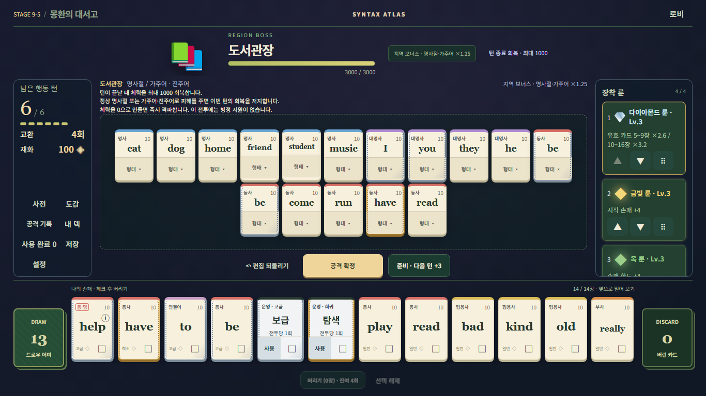
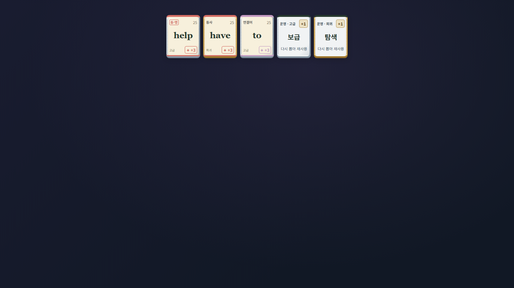
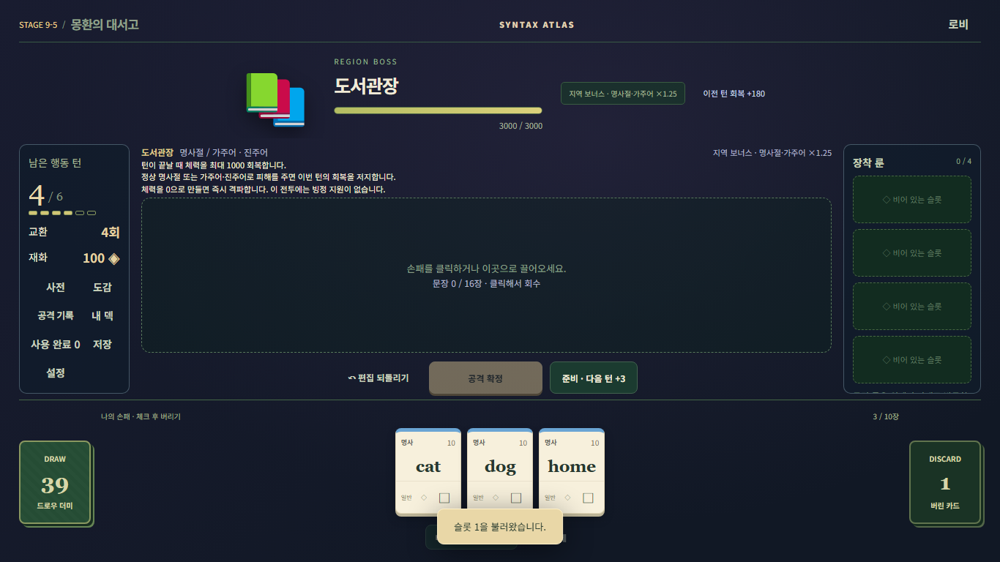
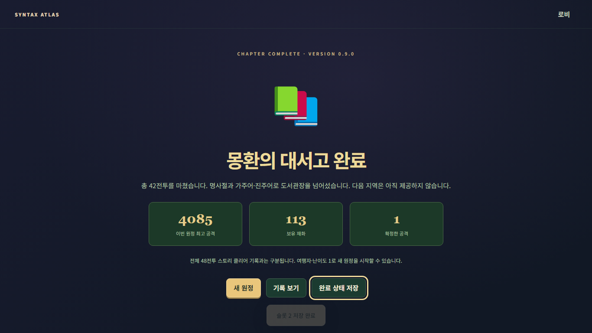

# Syntax Atlas 0.9 실제 검증 보고서

기준: 작업 시작에 fetch한 `origin/main` **0915161fecd6466c7b95f9f1195f661ef086a9d3** (0.8.1). 시작 checkout clean. 개발 브랜치 `codex/v0.9-dream-library`. 원본 ZIP과 이전 증거는 보존했다. 이번 날짜는 2026-10-12(KST)이며 아래는 이번 실제 실행이다. 과거 보고서의 PASS 수를 재사용하지 않았다.

## 판정 범위

Stage9/명사절/일반전 빙정/도서관장 회복과 확정 밸런스·UI는 구현했다. **자연 보상 새0.9 원정의42전투 완주·Stage9 자연 학습 경로는 NOT RUN**이다. 자동 정책은 실제 정상 패배했으며 지정 카드 검사로 이를 대체하지 않는다. 이 미검증 때문에 PR은 Draft이며 병합·배포 준비 완료로 보고하지 않는다.

- 순수 산술: 보스 fixture의 피해/회복/마지막턴을 독립 계산.
- 지정 Controller: 실제 카드·문법·점수·룬·공격/준비/보상/저장 명령. 카드·연마·룬은 사전에 배치했으므로 자연 획득 자료가 아니다.
- 지정 브라우저: 실제 UI 클릭·형태·공격·저장, 일부 최대배치용 합성 상태. Chromium/Firefox/WebKit.
- 지정 production: dist 하위경로의 개발 hook 없는 앱에 별도 QA 저장을 로드. 38~42 각 전투 실제 조작/피해/보상/정확 저장 검증. 다섯 전투에 각 별도 시작 fixture를 사용했다. 연마3·룬4개Lv3이며 HP·점수 강제 처치가 아니다. 연속 자연42완주가 아니다.
- 자연 Controller/production: 새28장→실제 공개 보상/상점/손패를 사용하는 자동 정책. 실패·도달 범위와 완주를 따로 기록.

## 환경과 실행

기존 폴더 내 Node24.19.0/npm11.17.0, Git2.51.0.windows.2, Playwright1.51.1 (Chromium134/Firefox135/WebKit18.4), Vite8.3.2를 재사용했다. 의존성/시스템PATH/OS/브라우저 프로필을 교체하지 않았다. 개발 서버 `127.0.0.1:5173`, production 검사는 각 전용 포트와 `/grammardealer/`를 사용했다. 브라우저는 격리된 일회용 context다.

이 환경에서는 sandbox 브라우저의 loopback 접근이 막혔다. 승인된 로컬 실행으로 전환하고 Chromium에 이번 검사에만 `--proxy-server=direct:// --proxy-bypass-list=*`를 적용했다. 기존 검사는 ignored transport import, 신규 검사는 launch 인자로 적용했다. 시스템 프록시/보안 설정 변경은 없다. 처음 접근 실패는 환경 실패로 보존한다.

각 명령은 순차 실행했다. 실행기 `.local-validation/v09/run-check.py`는 별도 실행 ID의 command.log/result.json과 출력 폴더를 남긴다. 고정 docs 출력은 이번 결과를 복사 후 이전 바이트로 복원했다. 공개 [summary.json](validation/v0.9/summary.json)에 실제 명령/종료코드/로그SHA를 보존하며 원본 로그·영상·저장은 로컬 `.local-validation/v09/`에 있다. 공개 보고서에는 개인 절대 경로나 저장 덤프를 넣지 않았다. 보고서 갱신 직전에 과거 문서·증거605파일을 실행 전 백업과 바이트로 대조했다. 이후 최신 인계/아키텍처/이슈 문서에는 의도한 새 절만 추가한다.

| 실행 ID | 실제 명령 | 종료 코드 | 결과/범위 |
|---|---|---:|---|
| baseline-unit | `npm.cmd test` | 0 | PASS — before edits baseline |
| baseline-data | `npm.cmd run validate:data` | 0 | PASS — before edits baseline |
| baseline-build | `npm.cmd run build` | 0 | PASS — before edits baseline |
| final-unit-04 | `npm.cmd test` | 0 | PASS — 1449 PASS / 0 FAIL / 0 SKIP |
| final-data-02 | `npm.cmd run validate:data` | 0 | PASS — 3090 PASS |
| final-build-03 | `npm.cmd run build` | 0 | PASS — 101 modules, JS523.85kB, chunk warning |
| official-browser-02 | `npm.cmd run test:browser` | 0 | PASS — 14 scripts whole chain exit0; reported counts272 + B/C/D/E phases |
| browser-final-02 | `npm.cmd run test:browser:library` | 0 | PASS — 81 checks / 66 captures; 3 engines |
| production-assigned-01 | `node tests/library-production-assigned.mjs` | 0 | PASS — 5 assigned battles / 15 captures; production STAGE9_END |
| production-natural-01 | `npm.cmd run test:e2e:library` | 1 | FAIL — new0.9 natural production; see failure classification below |
| production-legacy081-01 | `npm.cmd run test:e2e:waterways` | 0 | PASS — explicit0.8.1 initial save / actual production UI |
| legacy-help-browser-01 | `node tests/grammar-polish-browser.mjs` | 0 | PASS — 87 PASS / 93 captures; 3 engines; left badge |
| production-natural-course-01 | `npm.cmd run test:e2e:library` | 1 | FAIL — SB_LIBRARY_COURSE=1; natural Stage9 learning route attempt |

## 실제 수정 중 발견한 오류와 재검사

1. Stage8의 선택/상점 영수증 검증이9지역을 허용하지 않던 연결 누락: 실제 저장 validator 실패 후 새0.9 한정으로 확장. 과거081의37경계는 그대로다.
2. what 명사절 주어의 카드가 바깥 수일치 오류 anchor로 사용되어 정상 내부절까지 RECOVERED가 되던 신규 문제: `What I need are water.` 실제 FAIL(`locality-before-01`) 후 constituent 고유 causeId와 가주어 anchor로 오류 범위를 분리했다. `What she need is water.`는 공략 비대상으로 유지. `locality-after-01`과 최신 브라우저가 회귀 근거다.
3. Stage9의 최대배치에서 조작 버튼 높이가44px 미달: 기존 지역과 같은 최소높이만 적용. 16장 조합·손패10/14·4해상도에서 다시 검사했다.
4. 공식 v02 브라우저의 로비 버전 기대가0.8.1로 고정되어 실패: 0.9 표시로 갱신. 게임 판정/점수/HP 기대를 낮추지 않았다. 새 문법 오류 fixture는 공략 근거0뿐 아니라 전체 문장을 오류 없는 VALID로 수용하지 않는지도 단언한다.
5. 0.8.1 전용 guide 테스트는 해당 버전의8지역만, legacy helper/E2E는 명시적으로081 원정을 검사하게 했다. help 배지 geometry는 명세의 좌상단 변경에 따라 badge.right≤score.left로 갱신했다. 크기·비중첩 조건은 유지했다.
6. 자연원정 QA의 룬교체 정책이 초반에도4슬롯을 가정해 발생한 도구 오류(`natural-controller-03`): 실제 slotLimit 사용으로 교정했다. 이어 실행한04/05는 정상 DEFEAT, 엔진 오류0. 이 오류를 게임 버그로 보고하지 않는다.
7. 개발 중 파일 변경으로 Vite가 테스트 페이지를 재로드한 `browser-05` Chromium 실패는 도구 실행 충돌이었다. 최종 검사는 소스 변경 없이 다시 실행했다. 앞선 부분 PASS를 최종 전체 PASS로 합산하지 않는다.

## 자연 보상 조사와 난이도 한계

최종 Controller 정책60회(`library.route.0`~`.59`)는 모두 정상 DEFEAT이고 엔진/명령 실패0이다. 패배 전투는7:16회,12:37회,17:1회,21:1회,22:1회,27:4회. 다이아몬드를 실제 보상/상점에서 획득한 원정5회, 획득하지 않은 원정55회를 포함한다. 각 실행의 실제 공격+준비 수, 공개 후보/선택/상점, 최종HP/턴은 raw JSON에 남겼다. 최초1회·중간40회·수정 후5회 및 도구 오류 실행도 삭제하지 않았다. 이 표본은 사람 승률이나 불가능 판정이 아니다.

Stage9에 도달하지 못해 자연 보상에서what/whether 제시→영구획득→보스사용, 실제 누적 회복/저지/총소모턴의 자연 Stage9 자료는 없다. 후보 생성 가능성은 별도의2400회 보상 생성/지정 상태로 검증했지만 자연 준비 가능성의 대체 근거가 아니다. 확정 HP·확률을 낮추거나 공략카드를 무료 지급하지 않았다.

- `production-natural-01`: 종료코드1/FAIL, QA_POLICY_DEFEAT. 전투7, 적HP74, 남은턴0, 실제공격17+준비3회. 페이지오류0/실패리소스0/HTTP오류0. 목표Stage9에 도달하지 못했으므로 학습5라운드는 NOT RUN.

- `production-natural-course-01`: 종료코드1/FAIL, QA_POLICY_DEFEAT. 전투7, 적HP74, 남은턴0, 실제공격17+준비3회. 페이지오류0/실패리소스0/HTTP오류0. 목표Stage9에 도달하지 못했으므로 학습5라운드는 NOT RUN.

- `production-legacy081-01`: 종료코드0/PASS. 명시적0.8.1 초기저장을 현재 production UI로 로드한 뒤 37전투, 실제공격79회/운영19회/62검사. STAGE8_END 저장·복원/마일스톤 중복방지, 설원 핵의 여러사본/비교외파괴/HP1보호/마지막핵처치를 확인했다. 새0.9 완주 증거가 아니다.

- `production-assigned-01`: 종료코드0/PASS. 다섯 지정 상태에서 실제 위력4085/4085/4508/2101/4085, 피해1700/1800/1900/2000/3000 및 보상/다음전투/마지막완료 저장15캡처. 첫네전투·보스 모두 실제엔진으로 처치했다. 자연보상·1턴빌드성공률 자료가 아니다.

별도 학습코스 모드(`SB_LIBRARY_COURSE=1`)는 각9-1~9-5의 실제 목표구문 제출을 단언한다. 일반완주만으로 통과하지 않으며 미도달결과는 각라운드NOT_RUN으로 남긴다. 최종 재빌드의 모든dist 파일SHA-256은 위 production에서 검사한 빌드와 동일하다.

## 보상·확정값과 초기값

`LIBRARY_CONFIRMED`: 도서관장3000/최대회복1000/보스지원0, 기존보스400/800/840/1200/1300/1600/1900/2200, 골렘각280, 룬194:97:9, 지정 WORD 등급.

`LIBRARY_INITIAL`: 일반HP1700/1800/1900/2000, what/whether 고급, 지역×1.25한번, 일반빙정what1/where+when각1/whether1/미보유that·it·to각1. 사용자 확정 난이도로 보고하지 않는다.

실제2400seed 생성: 룬 항목이 발생한 보상675회에서 COMMON454/UNCOMMON205/RARE16, 상점2400회에서1551/788/61. 이는 조건부 후보 분포이며 전투당 다이아몬드 획득 확률3%가 아니다. 실제 trace의194:97:9, 희귀가격32, 최대레벨 희귀소진 제외, 초회 고정/BASIC 예외를 각각 검사했다.

구버전 저장의 버전·HP·보상·상점·룬 이름/등급/배율·RNG를 새 정책으로 덮어쓰지 않는다. generator는081을 재사용하여28장 구성과have 고정/be2장을 유지한다. 기존306문법사례를 새09에서도 같은 status/frame/tags/issues/coverage로 대조했다.

## UI 증거와 미완료

최대조합16장/손패10·14장을1024×768,1280×800,1366×768,1920×1080에서 검사했다. 카드 표면의 긴 설명을 복원하지 않았고 은/금·help 좌상단·빙정·운영을 확인했다. 실제 diamond pulse/AudioManager mute 상태·effectsOff·OS reduced motion·cancel에서 정산1회와 입력 복귀를 검사했다. 녹화는 로컬에 보존한다. 실제 스피커 청취/실물 iOS Safari·Android 기기/교사·학생 사용성 평가는 NOT RUN이다. 독립된 구0.6.1 production27전투 기본 `test:e2e`, 기타 옛 지역 전용 browser/decks 명령은 이번에 각각 재실행하지 않아 NOT RUN이다. 전체 단위 묶음·공식14개 browser·081/09 집중 검사·081 production37을 실행한 범위와 구분한다.

Stage9 전용 원화/배경 원본/BGM은 패키지에 없으므로 emoji와 기존 테마 체계 fallback이다. 별도 제작 완료를 주장하지 않는다. production JS 단일청크가500kB 경고를 내지만 빌드는 성공했다. 분할/새 자산/다른 룬조정은 이번에 임의 추가하지 않았다. 미래 로드맵에 예약된 다이아몬드 이름과 현재 표시명의 충돌은 문서 과제로 남긴다.

## 변경·원격 작업

코드·언어/지역 데이터·테스트·명세·문서를 수정했다. package/lock의 루트버전만0.9.0으로 변경했고 의존성 목록/고정버전은 동일하다. 원본 ZIP, 런타임, .baseline-backup, 기존 증거는 보존했다. 빌드/dist·node_modules·원본 로그·영상·임시 백업은 commit 대상에서 제외한다. 변경 파일 목록은 [실행 근거](validation/v0.9/summary.json)와 PR diff에 있다.

기존 workflow의 Pages 업로드/배포는 main이며 PR이 아닌 이벤트로 한정되어 있다. 설정은 변경하지 않았다. main 직접push/merge/auto-merge/Pages 설정 변경/공개 배포를 수행하지 않는다. 브랜치 commit/push 및 Draft PR 결과는 별도 remote 기록에 연결한다.

다음 검토는 자연0.9 원정의 장기 덱 운영과 Stage9 목표카드 보상 준비를 확보하는 것이다. QA 정책을 개선해도 게임 확정값이나 검사를 완화하지 않는다. AC-085/088의 자연 흐름 증거가 확보되기 전에는42전투 완주 검증 완료로 승격하지 않는다.
