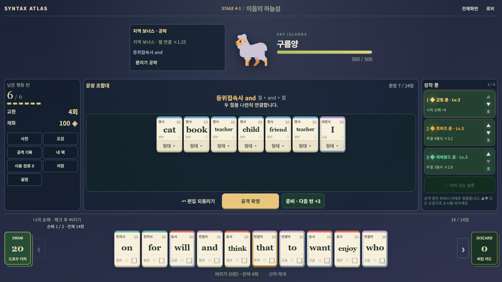
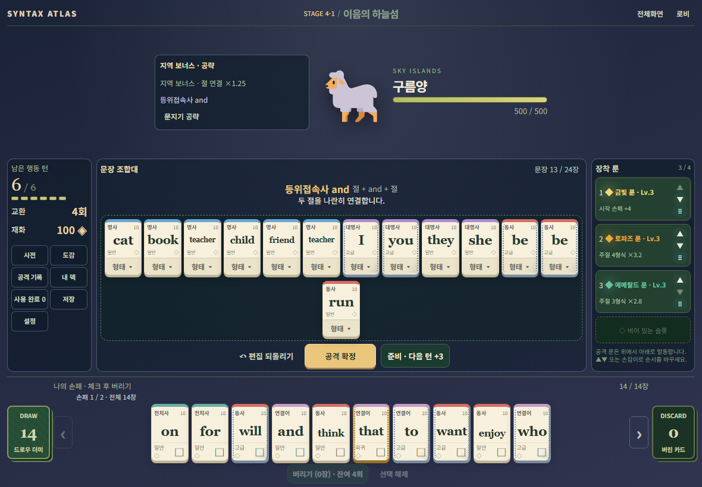

# 최종 전투 UI 배치 · 실제 검증

2026-10-16. 기준은 fetch한 `origin/main` **0866906bfbe64bbf9ac8b665c9d3b9afb4184df9**(PR17 병합, 0.10.2). 시작 작업 트리는 clean이었다. 브랜치 `codex/final-battle-layout-polish`. [사용자 지시](../spec/final-battle-ui/BRIEF_KO.md)와 두 시안을 기준으로 하며, 이전 UI Recovery의 좁은 창 상단 패널 배치를 대체한다. 0.10.0 `f09d453`의 전투 마크업을 참고만 했다.

## 변경과 보존

- 상단 중앙 몬스터, 왼쪽 지역 안내, 오른쪽 이름·제한 길이 HP. 보스의 실시간 상태는 HP 근처, 자세한 공략은 버튼으로 유지한다.
- PC 일반 창·전체화면·태블릿 모두 **상태 / 조합대 / 룬** 3열. 조합대는 12×2 고정 외곽, 각 행 중앙정렬이다. 일반 창의 측면 패널 폭을 확보하고 4룬의 효과·▲▼·드래그를 보존했다.
- 손패는 한 줄, 페이지당 최대10장. 같은 장면의 손패와 조합대는 동일한 카드폭·영문 크기다. 실제 카드 노드는 그대로 두고 표시 여부만 바꾸며, 페이지 사이의 체크와 물리ID를 유지한다. ResizeObserver는 화면 폭만 읽고 cleanup한다.
- 중앙 점수와 콤보는 기존 한 그룹을 유지한다. 긴 보스 설명은 기존 상세창에 보존하고 공격 전에는 짧은 목표를 표시한다. 기존 근거 카드 반응·콤보 누적·룬·돌진/피격을 유지했다.
- 상점 상품을 내용 높이로 묶고 연마·제거 영역을 압축했다. 형태창은 현재/원형 아래에 과거·p.p.·-ing 그룹을 나란히 배치하여 1366×650에서도 편집 버튼까지 보인다.

production 변경은 `src/ui/{responsive.css,combat.js,viewport.js,boardLayout.js,cards.js}` **5개뿐**이다. 문법·점수·HP·룬·보상·상점 경제·저장/버전·47전투·24장 한도, package/lockfile/workflow는 변경하지 않았다. 기존 테스트와 assertion은 삭제하거나 바꾸지 않았다.

## 이번 실행

기존 Node24.19.0/npm11.17.0/Playwright1.51.1 Chromium134 환경 재사용. 아래 명령은 저장소 루트 기준이다. 브라우저 검사는 `npm.cmd run dev -- --host 127.0.0.1`로 기동한 5173 서버를 사용한다.

| 실제 명령 | 결과 |
|---|---|
| `npm.cmd test` | **PASS**, exit0, 1,718 / fail0 / skip0 |
| `npm.cmd run validate:data` | **PASS**, exit0, 3,112 checks |
| `npm.cmd run build` | **PASS**, exit0, 117 modules; 기존 500kB chunk 경고 유지 |
| `node tests/final-battle-layout-browser.mjs` | **PASS**, exit0, 26 checks / 18 captures / page errors0 |
| `node tests/final-battle-form-browser.mjs` | **PASS**, exit0, 형태창의 13개 버튼 표시·hit-test, 회수 callback 1회 |
| `node tests/ui-recovery-production.mjs` | **PASS**, exit0, 3 checks / 10 captures |

대표 배치: PC1366×768의0/7/24장, 짧은PC1366×650의12/13장, 태블릿1180×820의24장, 넓은PC1920×1080의24장. 별도 하늘섬 비교 캡처는 PC7장·태블릿13장이다. 헤더/몬스터 중앙, 3열·행별 중앙정렬, 버튼 hit-test, 4룬 효과와 컨트롤의 패널 내 배치를 검사했다. Chromium fullscreen API 진입·복귀와 모달 복귀 때 원정 상태 동일성을 확인했다. 실제 OS 전체화면/물리 태블릿 검증을 뜻하지 않는다.

지정 상태 UI에서는 10장 한 페이지, 14장 두 페이지, 페이지 간 체크 후 교환, 12↔13번 카드 실제 pointer 드래그, 형태 선택·회수, 룬 드래그, 사전·도감·저장 복귀, **5장/24장 실제 엔진 제출**, charge/lunge/impact 및 중복 정산 거절, IndexedDB 정확 복원을 확인했다. 이는 자연 획득 원정이 아니다. production에서는 새 프로필/새 원정을 실제 UI로 시작하여 기존 실습의40/126 두 공격, 교환·준비·형태·보상·저장을 완료했다. `/grammardealer/` JS/CSS는200이며 production debug 전역은 없다.

형태창은 첫 시각 검수에서 하단 편집 버튼에 내부 스크롤이 필요해 여백을 추가 조정했다. 그 뒤 집중 검사를 실행하고 production 실습을 최종 빌드로 확인했다. 전투 본체의 이미 통과한 화면 행렬은 이유 없이 반복하지 않았다.

초기 새 테스트의 잘못된 룬ID, 선택 필드 누락 처리, 숨겨진 페이지의 단어 비교, 전투가 없는 상점 상태 렌더 호출은 **테스트 준비 오류**였다. 형태창 집중 검사의 첫 selector도 닫힌 회전 안내 dialog까지 포함해서 실패했으며 열린 형태창만 대상으로 바로잡았다. 실패 로그를 삭제하거나 PASS로 바꾸지 않았다. `final-layout-first`, `browser-v2/v3`, `browser-final` 실패 기록과 `browser-v4` 중간 PASS도 로컬에 보존했다.

[명령·검사 요약 JSON](validation/final-battle-ui/results.json). 원본 로그·전체 캡처·영상은 `.local-validation/v0101/final-layout-*`에 있다. 과거 `timing.json`/`reward-distribution.json`은 실행 전후 백업·복원했고 이번 출력만 별도 보관했다. 이전 보고서 결과와 이번 실행은 구분한다.

## 시안과 실제 화면 비교

시안과 실제 PC/태블릿 캡처를 나란히 배치한 로컬 문서 `.local-validation/final-battle-layout/comparison.html` 및 `side-by-side.png`를 직접 확인했다.

| 기준 | 확인과 의도적인 차이 |
|---|---|
| 상단/중간/하단의 위치 | 중앙 몬스터, 중간3열, 하단 한 줄을 유지. 시안2의 오른쪽 지역 안내는 최신 문구 지시대로 왼쪽에 둔다. |
| 12×2와 카드 가독성 | PC 카드 약70px, 태블릿 약63px. 적은 카드라고 확대하지 않는다. 시안2는7장이 조합대 폭을 거의 채우지만 실제 구현은12열을 기준으로7장을 가운데 묶는다. |
| 좌우 패널과 여백 | 같은 높이에서 시작. PC에서 약207px씩, 태블릿은 폭 제약으로 더 좁다. 큰 장식·배경 일러스트를 추가하지 않았다. |
| 손패 | 최대10장 한 줄과 좌우 버튼·명시적 페이지. 실제 버리기/선택 해제 버튼을 추가로 보존하여 시안보다 하단 조작 공간이 있다. |
| 표현·수치 | 기존 이모지·그라데이션·품사/희귀도 카드 유지. 시안의 그림·HP520·룬 수치·가상 문장은 복제하지 않았다. |

[PC 빈 조합대](validation/final-battle-ui/pc-empty.png) · [태블릿24장](validation/final-battle-ui/tablet-24.png) · [24장 채점](validation/final-battle-ui/score-24.png) · [상점](validation/final-battle-ui/shop.png) · [최종 형태창](validation/final-battle-ui/form-menu.png)

## 남은 범위와 인계

- **물리적 최소 폭**: 1,160px 미만에서는 가독성을 더 줄이거나 패널을 숨기는 대신 가로 스크롤을 허용한다. 작은 모바일에서 화면 전체가 한 번에 들어오지 않는 제약이 남는다. 가로 전용 안내는 보존한다.
- **NOT RUN**: 이번 전체 역사적 `test:browser` 묶음, Firefox/WebKit 재실행, 물리 기기/OS 전체화면, 자연47전투 완주. 본 UI 범위의 집중 검사와 production 실습을 수행했으며 이를 전체 원정 완주로 대신 보고하지 않는다.
- 일반 창의 긴 단어·룬 설명은 상대적으로 작다. 색감·장식·미세 간격은 실제 플레이 피드백으로 후속 조정한다. 기능 검사에서 남은 FAIL은 없다.
- 검토 순서: 새 원정 실습 → 카드 추가/형태/회수 → 13장 이상 행 경계 → 손패 페이지 체크·버리기 → 룬▲▼/드래그 → 저장/불러오기 → 상점·형태창. 24장 최대 배치 캡처는 지정 상태 QA임에 유의한다.
- 작업 브랜치만 push/PR 대상으로 사용한다. main 병합·auto-merge·Pages 설정·공개 배포는 수행하지 않는다.
