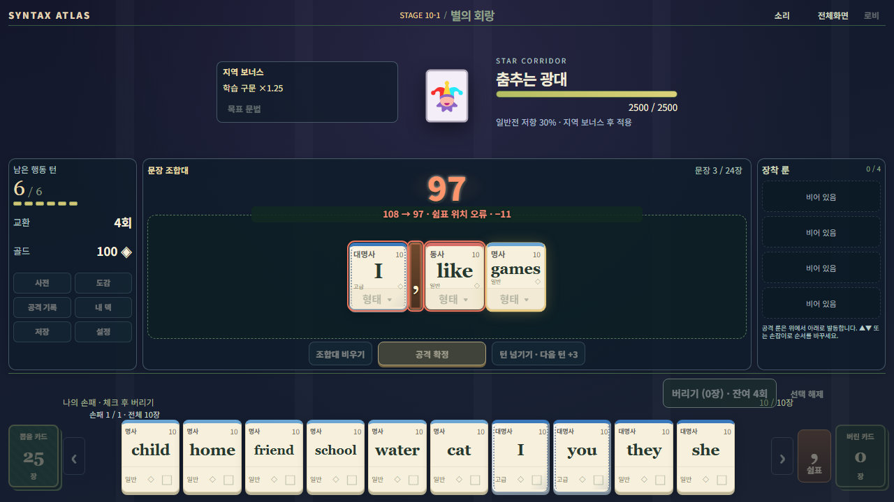
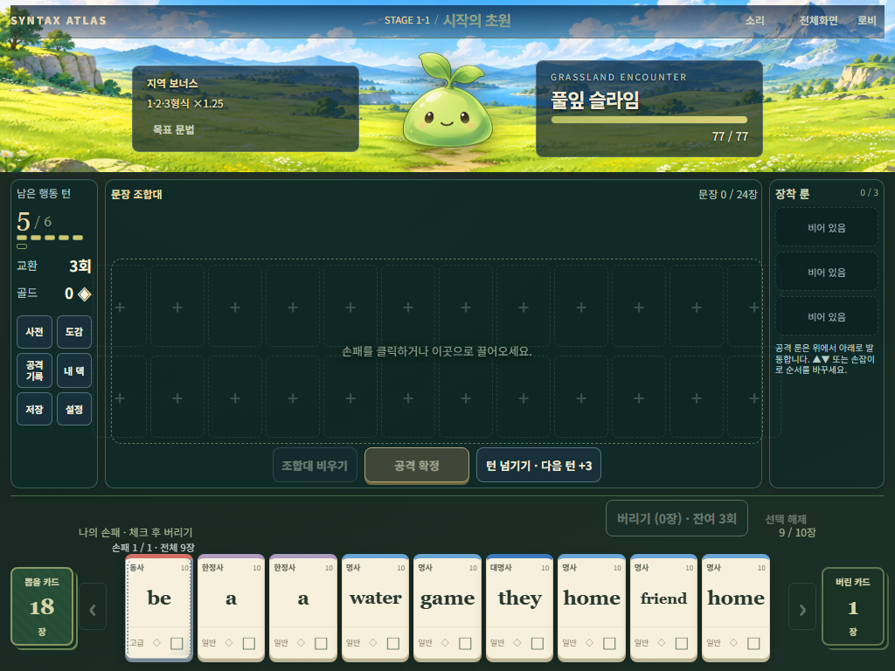
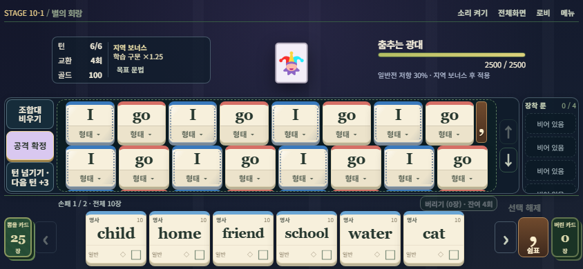
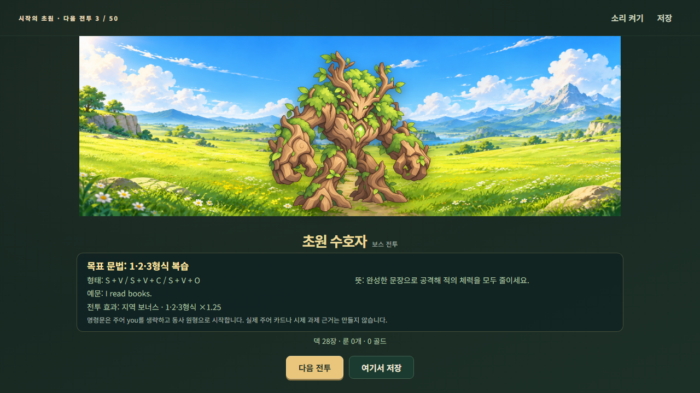

# v0.14.1 UI 가독성·작은 피드백 — 실제 결과

- 기준: 작업 시작 최신 `origin/main` **c19c8a78da6ee4a849a7123ecd200c0a608762d9** (PR #35). 시작 작업 트리는 clean이었다.
- 브랜치: `codex/v0.14.1-ui-feedback-polish`. 기존 branch/원본 ZIP/과거 증거를 보존했다.
- 앱/package: **0.14.1**. 원정/언어/채점/저장 계약은 **0.14.0 그대로**. `src/game`, `src/data`, `contracts.js`, 저장·오디오 서비스에 diff 없음. lockfile은 루트 앱 버전 두 곳만 변경, 의존성 변경 없음.
- 환경: Windows, Node 24.19.0, npm 11.17.0, Playwright 1.51.1 / Chromium 134. 기존 `.local-tools` 재사용. 이 보고서는 이번 재실행 결과다.

## 변경

쉼표는 단어와 같은 높이의 갈색 바로 표시한다. WORD 칸이 아니며 해당 행 경계만 공간을 확보한다. 모바일 8열·PC 12열·24단어, 실제 anchor·회수·반복 사용은 유지했다. 휴대폰 도구는 44×58px이다.

지역 보너스는 제목/조건·실제 배율과 `목표 문법` 하나로 정리했다. 긴 조건 목록은 `학습 구문 ×실제배율`로 요약하며 기존 전체 조건·문법·정적 공략은 창에서 읽는다. 실시간 보스 노드는 보존했다. 휴대폰 자원 세 줄은 보너스 왼쪽에서 retained 갱신하고 PC/패드 자원 위치는 그대로다. 더미와 튜토리얼 문구는 `뽑을 카드`/`버린 카드`, 빈 룬 슬롯은 `비어 있음`이다.

INSERT는 layout에 참여하지 않는 청색 경계다. SWAP은 기존 대상 표시를 유지한다. 실제 명령이 없는 손패 내부 이동, 꽉 찬 조합대·손패, 봉인 대상 등은 가짜 삽입 안내를 내지 않는다. 원본 카드와 ghost 크기·offset 경로는 바꾸지 않았다. SET_FORM 성공 뒤 실제 새 DOM의 cardInstanceId만 240ms 테두리를 강조한다. 취소·실패·무변경에는 반응하지 않는다.

확정 ScoreEvent의 문법 감점은 감소량을 한 번만 표시하고 실제 근거 카드와 쉼표만 350ms 강조한다. 저항은 청회색으로 분리하고 최종 위력에서는 점수 tier의 색으로 복귀한다. 점수 계산/정산/이벤트 순서 변경은 없다.

이미지는 현재와 인접 최대 두 장면만 준비하고 URL 요청을 합친다. decode 또는 유효한 load 크기를 확인하며 기존 bounds/앵커로 먼저 fit한다. 배경+idle 표시 묶음 대기는 최대 600ms이며 버튼/Controller/오디오 제스처는 기다리지 않는다. 실패·미등록 fallback, view cleanup, 사망 후 늦은 로드를 구분한다. 전체 에셋 다운로드나 새 영구 캐시는 없다.

18px/16px 바, 3px 삽입선, 240/350/600ms는 표시 조정값이며 사용자 확정 게임 수치가 아니다.

## 실제 실행

[명령·시각·종료 코드·로그 해시](evidence-ui0141/commands.json). 원본 로그와 개발 중 실패 증거는 로컬 `.local-validation/v0141/`에 보존했다. 기존 고정 출력 증거는 실행 전 백업 후 이번 결과를 따로 보관하고 복원했다.

| 명령 | 종료 | 결과 |
|---|---:|---|
| `npm.cmd test` | 0 | **1,997 PASS**, FAIL/skip 0 |
| `npm.cmd run validate:data` | 0 | **3,668 PASS**, 언어 정책 0.14.0 |
| `npm.cmd run build` | 0 | production build PASS; 기존 500kB chunk 경고 유지 |
| `node tests/ui-feedback0141-browser.mjs` | 0 | 집중 UI 6개 흐름 PASS |
| `node tests/comma-browser.mjs --no-captures` | 0 | 기존 쉼표 3개 흐름 PASS |
| `node tests/ui-feedback0141-browser.mjs --section=T5-image-ready-delay-failure-life --no-captures` | 0 | HTTP 404 추가 확인 PASS |

브라우저 실행은 `SB_BASE_URL=http://127.0.0.1:5174/`와 기존 Playwright 캐시를 사용했다. 합성 상태는 실제 소유 카드·Controller 명령·확정 AttackResolution으로 제출했다. 자연 원정 승률/50전투 완주 결과가 아니다. 실제 UI 공격, 2배속 집결/돌진, 효과 끄기와 reduced motion, IndexedDB 저장을 구분해서 확인했다.

초기 검사 하네스의 닫힌 dialog 선택, 정적 효과에서 이동 복사본 기대, 파노라마 부품의 단독 마운트, 저장 registry/명령·구버전 안전 저장 조건을 바로잡았다. 짧은 감점 캡처는 polling으로 순간을 놓쳤으므로 실제 프레임의 라벨 치수·가시성을 확인하도록 바꿨다. 실패한 실행(`final-browser`/`final-feedback` 포함)은 보존했으며 최종 결과로 재사용하지 않았다. 마지막 손패 내부 삽입 안내 보완 후 기본 test/build도 다시 실행했다.

기존 테스트 기대 변경은 앱 버전, 번역된 더미 이름, 통합된 안내 위치, INSERT 글자→경계 바에 한정한다. assertion 삭제/skip/허용 오차 완화나 게임 기대 수치 변경은 없다. 나머지 과거 standalone browser 전체 묶음은 실행하지 않았다.

## 인수 조건과 근거

PASS는 아래 자동화/코드 대조 범위이며 실기기 인증을 뜻하지 않는다. [집중 검사 상세](evidence-ui0141/focused.json) · [쉼표 상세](evidence-ui0141/comma.json) · [404 추가](evidence-ui0141/image404.json).

| AC | 상태 | 근거 |
|---|---|---|
| 01 | PASS | T6 바 16×60px, 옆 단어 높이 60px; PC도 동일 높이 실측·캡처 |
| 02 | PASS | 기존 쉼표 검사: 8×3 / 12×2, 마지막 단어·줄 끝 anchor |
| 03 | PASS | 탭/드래그/목록/회수/페이지, 도구 44×58px, 모바일 손패 하단 8px |
| 04 | PASS | T1·T6 제목/짧은 실제 배율/목표 문법 하나, 반복 안내 제거 |
| 05 | PASS | T1·T6 도움말 전후 상태 전체 동일, 버전별 기존 정적 안내 연결 대조 |
| 06 | PASS | T1 더미/빈 룬 문구, 기존 draw/discard 동작 연결·튜토리얼 문구 대조 |
| 07 | PASS | T1 준비·교환 뒤 자원 5/6·3회·실제 골드, 헤더 중복 0 |
| 08 | PASS | PC1280×720/패드1024×768 자원·상단 DOM 동일; 실시간 보스 노드 경로 보존 대조 |
| 09 | PASS | T3 실제 INSERT와 최종 순서, hover 전후 카드 rect 동일, 기존 ghost 경로 보존 |
| 10 | PASS | T3 SWAP 구별·24장 추가/손패 내부 무효 안내 없음; 봉인/운영/장애물 기존 제한 경로 대조 |
| 11 | PASS | T3 최종 좌표 사용, 기존 쉼표 검사 줄 끝/처음/마지막/스크롤·순서 이동 |
| 12 | PASS | T3 취소, 기존 쉼표 다중 터치·viewport·fullscreen cleanup, input guard 단위 회귀 |
| 13 | PASS | T4 실제 형태 성공 ID만 반응, 무변경·취소·실패 반응 없음 |
| 14 | PASS | T4 새 DOM ID/rect 동일; 이전 timer·view 정리 경로 대조 |
| 15 | PASS | T4 실제 108→97, −11 한 번과 붉은 라벨; 단위 검사 0차이·방어 구별 |
| 16 | PASS | T4 highlightCardIds 일치·실제 쉼표만 강조, 다음 이벤트/종료 cleanup |
| 17 | PASS | T4 저항 청회색·오류 카드 없음; HP 보호/0차이 분류 단위 검사 |
| 18 | PASS | T4 effectsOff/reducedMotion 정보 유지, 정적 모드에서 이동 복사본 없음 |
| 19 | PASS | T5 기존 3:1 파노라마·보스 bounds, 로드 전후 전투 scale/무대 rect 동일 |
| 20 | PASS | T5 요청 지연/실패/404·미등록 Stage10 fallback, 사망 완료 후 이미지 도착·해제 callback |
| 21 | PASS | 요청 합치기/두 장면 eviction/실패 재진입/decode fallback 단위 검사, 서비스워커 없음 |
| 22 | PASS | 실제 제출 1회 정산, 2배속 core FX·전체화면 드래그·310px 가시 높이, 오디오 단위 회귀 |
| 23 | PASS | T7 0.14 원정(쉼표 포함) 전체 상태 왕복; 0.8 기존 안전 지점의 실제 카드 회수 후 저장/복원 동일, 필수 단위 회귀 |
| 24 | PASS | 위 명령과 7묶음, 대표 4장·미실행 범위 기록 |

## 대표 화면

PC와 휴대폰은 지정 카드 상태, 준비 화면은 실제 renderBetween의 지정 상태다.

## 제한과 인계 상태

- 실기기 iPad/iPhone/Android, 카카오톡·인스타, 실제 터치 확대/청취: **NOT RUN**. Chromium touch/viewport 에뮬레이션으로 대체 인증하지 않는다.
- 자연 50전투, 대량 seed, 전 브라우저/기기 순회, production UI 전수 검사: **NOT RUN**. 이번 요구 범위 밖이다.
- 새 원화/보스 완료 UI/공격 기록 구조 해설/공용 랭킹은 추가하지 않았다. 미세한 색·간격은 사용자 플레이 피드백으로 후속 조정한다.
- 기존 큰 JS chunk 경고는 유지하며 범위 밖 분할 리팩터링은 하지 않았다. 확인한 기능 차단/입력 잠금/중복 정산 실패는 남지 않았다.
- 개발 브랜치 PR로 인계한다. main 병합·자동 병합·Pages 설정 변경·공개 배포는 하지 않는다.
