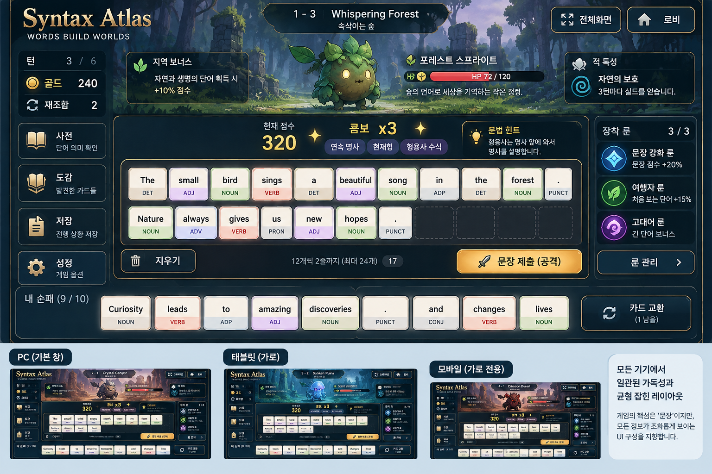

# Syntax Atlas — UI 복원·공간 정돈·24장 조합대 구현 지침

**리비전 2.0 · 2026-10-16 · Codex 작업용**

> **0.10.0에서 좋았던 PC 화면을 되살리고, 승인된 시안의 균형 잡힌 공간 배분을 실제 게임에 적용한다. 조합대는 손패 카드 12장×2줄만큼만 확보한다. PC 일반 창과 태블릿 가로에서도 전체화면 없이 정상 플레이되어야 한다.**

이 문서는 기존 `Syntax_Atlas_UI_Recovery_Brief.md`를 대체한다. 기존 0.10.1 및 UI Followup 명세와 충돌하는 **UI 배치·카드 용량·작업 우선순위**에는 이 문서와 사용자의 최신 지시를 우선한다. 룬·HP·획득 규칙 등 충돌하지 않는 완료 기능은 보존한다.

이 문서는 **기존 분석 자료와 이후 사용자 합의에 근거한 구현 지침**이다. 여기서 새로 게임 실행·실기기 검증·배포를 수행한 것은 아니다.

---

## 1. 목표와 작업 범위

이번 작업은 게임 전면 재작성이나 새 테마 제작이 아니다. **UI 복원·정돈이 주 작업이며, 문장 한도 16→24는 분리된 기능 변경**이다.

- **복원:** PC 창모드 로비의 문구와 기존 화면 위계, 중앙정렬, 점수와 타격 연출의 가시성.
- **정돈:** 과대 조합대 축소, 적·HP·문법 안내·좌우 패널 공간 회복, 손패와 조합대의 카드 규격 통일.
- **연결:** 전체화면 진입/종료, 태블릿·휴대전화 가로 플레이, 사전·도감·저장·형태 선택 등 기존 기능.
- **확장:** 새 원정의 실제 제출 한도 24장, 최대 12장씩 두 줄 배치.

### 변경하지 않을 것

0.10.1의 신규 룬 10종, 자수정 명칭, 기존 토파즈 4형식, HP 조정, 룬 획득 경로·확률, 문법 배율, 보스 기믹, 턴 제한, 손패 한도·드로우, 저장/불러오기 정책, 47전투 종료 경계를 보존한다. 새 문법·룬·최종 보스·난이도·상점·자동 정답/점수 미리보기를 추가하지 않는다.

24장 때문에 파서·검증기의 문장 길이 경계를 조정하는 것은 범위에 포함한다. 이를 이유로 문법 판정을 느슨하게 하거나 피해 배율을 상향하지 않는다.

### 기준 소스

- **이전 분석 시점의 구현:** `8df20b9a40ba5d12c1d10d9f63b35db5f9714347` — 0.10.1.
- **UI 복원 참고:** `f09d4537b3bfa28d2736045944da363c8a04abfc` — 0.10.0.
- 실제 작업은 `YEOMT/grammardealer`의 **착수 시점 최신 main 또는 사용자의 진행 브랜치**에서 계속한다. 두 SHA는 비교 기준이며 최신 상태라는 주장이 아니다.
- `AGENTS.md`를 먼저 읽고 현재 변경을 보존한다. 과거 UI 파일 전체를 덮어써서 신규 룬·형태 선택·전체화면·저장을 롤백하지 않는다.
- 이미 병합된 0.10.1의 후속 패치라면 기본 버전 후보는 `0.10.2`이다. 최신 저장소의 버전·진행 작업과 충돌하지 않게 확인한다.

## 2. 승인 시안: 무엇을 가져오고 무엇을 가져오지 않는가

첨부 `references/Approved_UI_Direction.png`는 사용자가 긍정적으로 평가한 **시각적 방향**이다. **상단의 큰 전투 화면만 참고하고, 하단 PC/태블릿/모바일 비교 썸네일과 설명판은 게임에 넣지 않는다.**



### 가져올 디자인 기준

1. 몬스터와 지역 분위기가 보이는 상단, 타이트한 중앙 조합대, 분명한 좌우 정보, 분리된 하단 손패의 균형.
2. 숫자·현재 콤보·문법 안내가 서로 겹치지 않는 정보 위계.
3. 어두운 배경 위의 밝은 카드, 절제된 테두리, 읽기 쉬운 이름·HP·버튼.
4. 사용하지 않는 조합대 공간을 과도하게 키우지 않는 밀도와 정렬.

### 복제하면 안 되는 시안의 임시 요소

| 시안 요소 | 실제 구현 기준 |
|---|---|
| 가로로 납작한 단어 타일 | 사용자가 만족한 **기존 손패 카드**의 너비·영어 글자·기본 구성을 기준으로 한다. 세로 여백만 조절한다. |
| 임의의 지역/몬스터 이름·HP·스킬 | 현재 게임의 실제 데이터와 설명을 사용한다. 시안의 적과 기믹을 새로 만들지 않는다. |
| 자연 관련 단어 보너스, 임의 룬과 효과 | 기존 지역 보너스·장착 룬·실제 수치를 표시한다. 의미 기반 새 보너스 금지. |
| `콤보 ×3` 표기 | 누적 연출 카운트는 **3 COMBO / 연쇄 3**처럼 표시한다. 새 피해 배율로 오해시키지 않는다. 실제 ×배율은 해당 효과값에만 붙인다. |
| 마침표 카드·여러 독립 문장의 예시 | 구두점 카드를 추가하지 않는다. 실제 한 번의 제출 스냅샷을 기존 문법 엔진으로 분석한다. |
| 덜 찬 둘째 줄의 왼쪽 정렬·정확하지 않은 열 수 | **한 줄 최대 12장, 각 줄 중앙정렬, 총 24장**을 텍스트 명세대로 구현한다. |
| 룬 3칸 고정, ‘지우기’만 있는 행동부 | 실제 원정의 룬 슬롯 수와 **되돌리기·공격·준비·교환**을 보존한다. |
| 거대한 그림·화려한 장식 | 이번에는 기존 배경/이모지 또는 준비된 실제 자산으로 배치한다. 전용 원화 제작은 선행 조건이 아니다. |

**우선순위는 최신 사용자 요구 → 이 문서의 기능/배치 규칙 → 승인 시안의 공간 인상 → 이전 명세다.** 그림과 규칙이 충돌하면 실제 규칙을 지킨다.

## 3. 이전 분석에서 확인한 회귀와 남은 불확실성

아래는 원본 Recovery Brief에 기록된 결과다. 이번 문서 수정에서 다시 측정한 값이 아니다. 코드는 바뀌었을 수 있으므로 해당 원인이 현재도 남아 있는지 짧게 확인한다.

| 원인/관측 | 복구 방향 |
|---|---|
| `@media(max-width:719px),(max-height:699px)`가 넓지만 높이가 낮은 PC에도 적용되어 로비 소개 등을 `display:none` 처리 | PC 로비의 문구를 복원하고, 높이 부족에 대한 간격 조절과 모바일 전용 재배치를 분리한다. |
| PC까지 `.responsive-battle`의 적 높이 86px/64px, 좁은 패널, 조합대 `flex:1`이 적용 | 조합대는 카드 두 줄 크기로 제한하고 상단·패널에 공간을 돌려준다. |
| 조합대 `justify-content:flex-start` | 각 행 중앙정렬 복원. |
| `.score-stage>div{flex:1}`가 숫자에도 적용 | 숫자와 콤보를 콘텐츠에 맞는 중앙 그룹으로 묶는다. |
| `sentenceLimit:16` 유지 | UI만 24칸으로 바꾸지 말고 새 원정의 실제 입력·분석·저장 경계까지 24장으로 연결한다. |

이전 메모리 모드 Chromium 재현에서 카드 3장 조합대는 1920×900에서 **1610×493px**, 1366×650에서 **1056×295px**였다. 전자는 카드가 적은데도 조합대에 과도한 공간이 배정되는 문제를 보여준다. 이 수치를 모든 기기의 현재 상태로 일반화하지 않는다.

**콤보·피격 소실의 원인은 아직 확정되지 않았다.** 당시 `She is sad.` 단순 공격은 재생됐다. 한 사례가 통과했다고 사용자 제보를 종료하지 말고, 일반 창의 긴 문장/룬 공격에서 표시 오류·좌표·잘림·중도 정리·효과 설정을 확인한다. 효과가 항상 꺼져 있다고 단정하지 않는다.

## 4. 기본 화면 설계 — 전투 전체를 한 장면으로

### 4.1 기본 순서와 위계

| 구역 | 항상 보여야 할 내용 | 공간 규칙 |
|---|---|---|
| **헤더** | 왼쪽 게임명 / 화면 정중앙 스테이지 단계·이름 / 오른쪽 전체화면·로비 | 낮고 안정적인 한 줄. 전체화면은 로비 바로 왼쪽. |
| **상단 적 영역** | 몬스터, 옆의 이름·HP·핵심 기믹, 지역 보너스 | 내용과 실제 그림이 들어갈 여유를 확보한다. 조합대 남은 공간에 밀려 64px 띠가 되어서는 안 된다. |
| **중앙 왼쪽** | 턴·교환·재화, 사전·도감·내 덱·저장 등 | 버튼과 클릭 영역이 패널 안에 들어오고 읽혀야 한다. |
| **중앙 중심** | 목표 문법/콤보 표시 → 12×2 조합대 → 행동 버튼 | 조합대 외곽의 크기는 카드 규격으로 제한한다. 점수·버튼 공간을 포함해 안정적으로 유지한다. |
| **중앙 오른쪽** | 실제 장착 룬·레벨·짧은 효과·정렬 접근 | 빈 공간이 있는데도 효과를 일괄 숨기지 않는다. 긴 이름을 정상 줄바꿈한다. |
| **하단 손패** | 보유 카드, 덱/버린 카드, 교환과 선택 상태 | 기존 카드 정체성과 중앙정렬 유지. 14장 확장 상태도 함께 고려한다. |

**남는 공간 = 조합대를 늘리는 공간이 아니다.** 적 영역의 적절한 여유, 패널의 읽기 폭, 영역 사이의 숨 쉴 간격에 배분한다. 그렇다고 몬스터 무대나 장식만 과도하게 확대하지 않는다.

### 4.2 PC와 태블릿은 같은 정보 위계, 필요한 경우 다른 배치

- **넉넉한 PC:** 익숙한 왼쪽 상태/중앙 조합/오른쪽 룬의 3열을 유지한다. 중앙 조합대는 12장 폭에서 멈춘다. 화면 전체를 카드로 채우려고 늘리지 않는다.
- **PC 일반 창:** 전체화면과 같은 요소·정렬·기능을 사용한다. 창 높이가 낮다는 이유만으로 로비 문구·룬 설명·핵심 조작이 사라지는 모바일 스킨을 적용하지 않는다.
- **태블릿 가로:** PC를 통째로 축소하지 않는다. 12장 카드 폭과 좌우 패널이 함께 들어가면 3열을 유지한다. 들어가지 않으면 **상단에 상태/적/룬을 묶고 그 아래 조합대를 넓게 쓰는 압축 배치**를 사용한다. 내용·기능은 그대로이고, 과대 조합대 대신 실제 두 줄 높이만 사용한다.
- 위 태블릿 재배치는 폭 부족을 해결하는 **지정 대안**이다. 정상적인 넓은 PC까지 무조건 이 구조로 바꾸지 않는다. 상단이 복잡해지면 긴 상세만 모달로 옮기고 이름·HP·턴·현재 보스 조건은 남긴다.
- 헤더 중앙은 좌우 그룹 사이 남은 공간의 중앙이 아니라 **게임 화면 전체의 중앙**이다. 이름이 길거나 전체화면 버튼 문구가 바뀌어도 서로 겹치지 않는다.

### 4.3 공간의 고정 원칙과 조정 가능한 시작값

사용자가 확정한 것은 **배치 관계, 동일 카드 너비/글자, 12×2, 중요 정보의 가시성**이다. 아래 수치는 구현 시작점이며 새로 승인된 절대 규격이 아니다.

- 상단 적 영역: 넉넉한 PC/태블릿에서 약 **140~220px**부터 맞춰보고, 실제 화면 높이·보스 정보량에 따라 조정한다. 24장·손패 14장 상태를 함께 보고 결정한다.
- 콤보/문법 표시: 약 **52~76px**의 고정 구역부터 검토한다. 긴 이름 때문에 조합대가 내려가지 않게 한다.
- 행동 버튼: 한 줄에 놓고 조합대와 가까이 유지한다. 클릭/터치 영역을 확보한 뒤 간격을 조절한다.
- 조합대 외곽은 아래 공식으로 계산한다. **남는 높이를 받는 `flex:1`이나 필요 이상 큰 최소 높이를 두지 않는다.**
- 태블릿은 브라우저 주소창이 보일 때의 **실제 가시 영역**을 기준으로 맞춘다. 전체화면일 때만 정상인 배치는 완료가 아니다.

위 시작값이 동시에 들어가지 않으면 간격·상하 여백·패널 배치를 조절한다. 글자 은닉·보스 정보 삭제·카드 가로 늘임·전역 축소로 수치를 억지로 맞추지 않는다.

## 5. 12×2 조합대 — 가장 중요한 구현 계약

### 5.1 손패가 원본이다

0.10.0의 만족스러웠던 손패 카드 구성을 출발점으로 삼는다. 패치 과정에서 변형된 조합대를 새 기준으로 삼아 손패까지 납작하게 바꾸지 않는다.

같은 화면·같은 단어·같은 형태라면 손패와 조합대의 **가로 너비, 영어 글자 크기, 품사 색과 정보 위치**를 통일한다. 단어가 길 때 적용하는 기존 글자 맞춤 규칙도 공통으로 사용한다.

기기별 공통 카드 규격은 둘 수 있다. 그러나 **손패/조합대 위치, 현재 카드 수, 연쇄 단계**가 달라졌다는 이유로 너비나 영어 글자 크기가 달라지면 안 된다. 태블릿의 물리적 폭이 부족하면 먼저 §4.2의 배치를 사용한다.

### 5.2 외곽 크기

공통 카드 너비 `W`, 조합대 카드 높이 `H`, 가로 간격 `Gx`, 행 간격 `Gy`, 내부 여백 `P`, 테두리 `B`를 사용한다.

```text
조합대 외곽 너비 = 12W + 11Gx + 2P + 2B
조합대 외곽 높이 =  2H + Gy   + 2P + 2B
```

예: `W=96, H=97, Gx=6, Gy=8, P=6, B=1`이면 **1232×216px**다. 이는 기존 분석값을 이용한 산술 예시이지 모든 기기에 강제할 카드 크기가 아니다.

예: 같은 간격에서 `W=82`이면 조합대 너비는 **1064px**다. 1180px 태블릿에서 여기에 넓은 양측 패널을 추가할 수는 없으므로, 무리하게 압축하기보다 상단 패널 재배치를 사용한다.

빈 공간은 얇고 차분하게 표현한다. 항상 24개의 큼직한 점선 칸을 그려 거대한 양식처럼 만들 필요는 없다. 삽입 위치 표시는 드래그할 때 명확히 제공한다.

### 5.3 행과 중앙정렬

| 제출 카드 수 | 배치 |
|---|---|
| 0장 | 짧은 조립 안내. 두 줄 용량의 외곽은 유지한다. |
| 1~12장 | 한 줄 전체를 중앙에 둔다. 예약된 두 줄 영역 안에서 세로도 자연스럽게 중앙 배치한다. |
| 13~24장 | 첫 줄은 1~12번, 둘째 줄은 13번 이후. **두 줄 각각 독립 중앙정렬.** |
| 25번째 추가 | 입력을 거절하고 기존 카드/선택 상태를 보존한다. |

첫 줄을 카드마다 넓게 늘이거나 덜 찬 둘째 줄을 왼쪽에 붙이지 않는다. 브라우저 너비가 크다고 한 줄에 15~18장을 놓지 않는다. **이전 ‘세 줄 이상 압축’과 ‘조합대 페이지 전환’ 지시는 이번 기본안에서 대체한다.**

세로로는 카드 내부 여백·행 간격을 조절할 수 있다. 글자와 문양을 `scaleY`로 찌그러뜨리지 않는다. 형태 버튼, 점수, 연마, 빙정/봉인 표시와 핵심 터치 영역을 없애지 않는다.

### 5.4 입력과 읽기 순서

행 래퍼를 추가하더라도 모든 동작은 **물리 카드 instanceId와 전체 문장 인덱스**를 기준으로 처리한다. `:scope > .word-card`처럼 직계 자식을 가정하던 선택자·관찰자·드래그·강조 기능을 함께 확인한다.

12↔13번째 경계의 삽입, 행 간 이동, 회수, 맞교환, 형태 선택, 되돌리기가 정상이어야 한다. 줄바꿈은 시각적 배치일 뿐 절 구분·문법 의미가 아니다. DOM 읽기 순서와 엔진 제출 순서는 같아야 한다.

행 계산/ResizeObserver가 프레임마다 높이를 바꾸며 진동하지 않게 한다. 카드가 줄을 바꿔도 외곽 용량과 하단 행동부 위치는 안정적으로 유지한다.

## 6. 상단 정보·좌우 패널·손패의 구체적 정리

### 적·문법·지역 정보

몬스터는 조합대 위쪽에, 이름과 HP는 그 옆에 둔다. 일반 몬스터와 보스의 크기는 정해진 영역 안에서 조절한다. 제목·HP·기믹이 그림의 투명 여백에 따라 흔들리지 않게 한다.

- **지역 보너스:** 지역 규칙으로 분리해 짧게 표시한다.
- **현재 보스 상태:** HP 가까이에 둔다. 예견 문형, 남은 빙결핵, 인장, 회복 조건 등 공략의 핵심은 상시 읽혀야 한다.
- **목표 문법:** 기존 라운드 안내를 사용한다. 실시간 제출 정답이나 예상 점수는 보여주지 않는다.
- 긴 예외 설명은 상세에서 읽도록 하되, 기믹 이름만 남겨 사용자가 매번 눌러야 하는 배치는 피한다.

배경/몬스터의 새 원화, 전용 BGM, 전체 테마 팔레트 재설계는 이번 작업에서 제외한다. **현재 자산으로도 여유 있게 보이는 배치**를 먼저 완성한다. 향후 자산 교체가 가능한 독립 요소만 유지한다.

### 좌우 기능과 룬

사전·도감·내 덱·저장·공격 기록·설정은 기존 기능을 보존한다. 글자뿐 아니라 테두리·포커스·클릭 영역까지 패널 내부에 들어와야 한다. 줄바꿈과 1열/2열 조정을 사용하고 `overflow:hidden`으로 문제를 가리지 않는다.

사전과 저장은 학생들이 실제 사용한 핵심 도구다. 좁다고 삭제하거나 알아볼 수 없는 아이콘만 남기지 않는다. 핵심 상태와 접근 버튼을 먼저 보이고, 부가 설명만 상세로 옮긴다.

룬은 실제 장착 순서대로 **보석·이름·레벨·짧은 효과**를 보여준다. 최대 슬롯 수는 원정 규칙을 따른다. 정렬 컨트롤을 줄일 수는 있지만 조작 접근은 유지한다. PC/태블릿에서 짧은 효과까지 일괄 숨기지 않는다.

### 손패와 행동

기존 손패 카드 정체성을 보존하고, 14장 확장 상태를 실제로 배치한다. 화면에 여유가 있으면 한 줄, 부족하면 읽기 크기를 지키는 명시적 배치를 사용한다. 손패 때문에 조합대가 다시 무한히 늘어나거나 몬스터가 사라지지 않게 **최대 손패 상태도 높이 예산에 포함**한다.

`편집 되돌리기 / 공격 확정 / 준비`는 조합대 아래, `교환 확정 / 선택 해제 / 남은 교환`은 손패 가까이에 둔다. 시안에 없다는 이유로 준비나 교환을 지우지 않는다. 공격과 준비는 서로 오입력하기 어렵게 구별한다.

## 7. 점수·콤보·타격은 ‘보이게 복원’하는 것이 먼저

### 표시 그룹

점수 숫자와 현재 문법/룬 효과는 **중앙의 한 묶음**으로 보여준다. 숫자는 필요한 폭만 사용하고 문구에는 읽기 좋은 폭을 둔다. 숫자 div에 `flex:1`을 줘 조합대 절반을 차지하게 만들지 않는다.

편집 중 기존 목표 문법 안내와 제출 중 점수/콤보는 예약 구역에서 전환한다. 동시 표시로 겹치게 하지 않는다. 숨김 상태의 안내나 `min-content` 규칙이 제출 화면 높이를 밀어내지 않게 한다.

초기 점수, 실제 효과값(`+50`, `×2.4`), 누적 연쇄 수를 구분한다. 큰 숫자는 검증되지 않은 새 폰트로 무조건 바꾸기보다 기존 가독성과 자릿수 대응을 유지한다. 한순간의 효과 때문에 문구가 잘리거나 조합대가 이동하면 안 된다.

### 현재 구현의 Game Feel 보존

근거 카드의 ‘또잉’, 룬 비행, 등급/레벨별 강조, 누적 글로우·파티클, 문장 돌진·몬스터 피격을 유지한다. 먼저 잘못된 숨김·좌표·레이어를 고쳐 **일반 창에서도 정상적으로 보이게** 한다. 새 연출을 추가하는 작업으로 범위를 넓히지 않는다.

카드 탄성은 내부 시각 요소만 움직이고 외부 슬롯은 고정한다. 점수·입자 레이어는 카드 크기나 문장 순서에 영향을 주지 않는다. 무관한 카드 사본을 강조하지 않는다.

전체화면 루트 안에서 모달·점수·이펙트가 함께 보이게 한다. 변형된 조상 요소/클리핑/중첩 순서와 현재 좌표를 점검한다. 회전·리사이즈 중 좌표 갱신이나 장식 정리는 가능하지만 **매 resize마다 공격 전체를 무조건 취소**하지 않는다.

효과 끄기·모션 감소 설정은 존중하되 숫자·실제 피해·핵심 피드백은 남긴다. 효과 표시 실패와 게임 결과 정산은 분리하고, 표시 오류를 로그 없이 성공처럼 숨기지 않는다. 정산은 기존 컨트롤러에서 한 번만 한다.

## 8. 로비·전체화면·가로 대응

### 로비

PC 일반 창에서 다음 소개를 포함한 기존 로비 내용을 복원한다.

> 단어를 잇고, 문장을 완성하고.  
> 당신의 한 문장이 모험의 힘이 됩니다.

문구와 장식·지역 소개를 창 높이만으로 일괄 삭제하지 않는다. 먼저 여백·제목 간격을 줄인다. 극단적으로 작은 창이나 확대 상태에서는 **내용 삭제보다 안전한 로비 스크롤**을 택한다. 전투의 무스크롤 요구를 로비에 잘못 확장하지 않는다.

### 전체화면

전체화면은 정상 UI의 필수 조건이 아니라 선택 옵션이다. 진입 전후 같은 가시 크기라면 같은 정보·정렬을 사용한다. 요청 성공/실패/시스템 종료에 따라 버튼을 실제 상태와 동기화한다.

전체화면 루트에 팝업과 효과가 포함되어야 한다. 전체화면 전환 때문에 게임을 재생성하거나 배치·카드·선택 형태·RNG를 바꾸지 않는다. API 미지원 시 가로 창모드 플레이와 안내를 제공한다. 자동 방향 전환이 모든 브라우저에서 가능하다고 가정하지 않는다.

### 태블릿·휴대전화

휴대전화/태블릿 전투는 가로 전용을 유지한다. 방향 잠금은 기존 지원 경로로 요청하고, 불가능하면 직접 회전 안내를 사용한다. 키보드가 열려 가시 높이가 줄어든 것을 방향 변경으로 오인하지 않는다.

휴대전화의 물리적 폭에 PC 카드 12장이 그대로 들어가는 것은 아니다. 기기별 손패/조합대 공통 규격과 보조 정보 압축으로 대응하되, **12×2와 읽기·터치 크기를 함께 만족하지 못하는 작은 화면은 별도로 보고**한다. 승인 없이 3행·숨김·자동 페이지 전환으로 성공 처리하지 않는다. 이 극단적 예외의 완벽한 해결 때문에 정상 PC/태블릿 복원을 무기한 지연하지 않는다.

사전·도감·공격 상세의 긴 목록은 모달 내부 스크롤을 허용한다. 닫기/검색/확인/취소가 항상 접근 가능해야 하고, 닫으면 이전 전투 위치로 돌아온다. UI를 맞추려고 사용자 확대를 강제로 취소하지 않는다.

## 9. 24장 실제 한도 — 별도 커밋에서 제한적으로 연결

- 새 패치 원정의 문장 한도를 24장으로 만든다. 17번째·24번째는 들어가고, 25번째는 상태 손상 없이 거절한다.
- 입력, 문장 스냅샷, 파서 토큰 제한, 검증기, 기여 카드 계산, 저장, 안내 문구의 **16장 가정**을 찾아 필요한 곳만 수정한다. 모든 숫자 16을 일괄 치환하지 않는다.
- 길이와 문법 복잡도 제한을 구분한다. 24장 허용을 이유로 모든 절 깊이·탐색 제한을 무제한으로 풀거나 비문을 유효 처리하지 않는다.
- 기존 저장 원정은 원래 rules snapshot과 한도를 보존한다. UI는 두 줄 용량이어도 현재 원정의 실제 한도를 표시한다. 이전 저장 16장을 새 24장 지원 실패로 오해시키지 않는다.
- 다이아몬드의 17~24장 처리는 **기존 10장 이상 구간의 같은 배율을 연장하는 최소변경안**이다. 이는 장수 확장과 정합성을 위한 구현 기본안이며 새 상위 배율 승인으로 해석하지 않는다. 현재 엔진의 `>=10` 처리를 확인하고 새 버전 설명을 정합화한다. 구버전 설명/값은 보존한다.
- 24장으로 강한 문장을 만들 수 있어도 이를 상쇄하려고 HP·저항·희귀도·룬 배율을 다시 조정하지 않는다.

## 10. 소스 수정 지점 — 전체 재작성 대신 문제 규칙 정리

이전 분석 기준 경로다. 착수 시 최신 구조를 확인한다.

| 경로 | 주요 확인점 |
|---|---|
| `src/ui/responsive.css` | PC까지 번지는 로비 숨김, 적 높이, 패널 축소, score flex, 조합대 무제한 확장/좌측정렬. 충돌 규칙을 정리하고 `!important`를 계속 덧붙이는 방식은 피한다. |
| `src/ui/styles.css` | 0.10.0에서 좋았던 카드·패널·점수 스타일을 선별 복원. 기존 신규 기능 스타일은 보존. |
| `src/ui/combat.js`, `boardLayout.js` | 12장 행 분리와 독립 중앙정렬, 실제 카드 ID, 행 수 관찰, 패널 배치, 조립/제출 상태 전환. |
| `src/ui/cards.js` 등 카드/드래그 모듈 | 행 래퍼 변경 시 직계 자식 선택자, 삽입 위치, 되돌리기, 강조·형태 메뉴 좌표. |
| `src/ui/viewport.js`, `orientation.js` | 가시 높이, 전체화면 실제 상태, 가로 안내, 키보드/확대 구분. |
| `src/ui/scoreEffects.js`, `src/engine/presentation.js` | 실제 점수/피격 가시성, 효과 루트·좌표·정리·중복 정산 방지. |
| `src/data/balance.js` 및 저장/분석 계약 | 새 버전 24장과 구버전 한도 격리. |

**0.10.0 파일을 통째로 가져오는 것도, 0.10.1 위에 모든 기기용 새 디자인을 다시 얹는 것도 금지한다.** 현재 코드에서 잘못된 공통 압축/늘임 규칙과 표시 경계를 고치는 방식으로 진행한다.

## 11. 작업 순서와 검증 — 플레이 가능한 결과를 먼저

### 작업 순서

1. 현재 브랜치/작업 트리와 `AGENTS.md` 확인. 기존 완료 기능을 보존한다.
2. **커밋 A: UI 복원.** 로비 숨김, 과대 조합대, 중앙정렬, 점수·패널·적 공간을 먼저 수정한다. PC 일반 창과 태블릿 가로에서 실제 렌더링을 본다.
3. **커밋 B: 24장 연결.** 기능 경계와 두 줄 입력을 필요한 범위에서 수정한다.
4. 실제 공격 한두 사례로 콤보·피격을 확인하고, 전체화면 왕복 및 사전/저장을 연다.
5. 필수 기능 검사와 빌드가 끝나면 남은 미세 디자인을 기록하고 인계한다. 픽셀 단위 완벽함을 위해 반복하지 않는다.

### 대표 확인 화면

**PC 일반 창 1366×650 / 넉넉한 PC 1920×900 / 태블릿 가로 1180×820**을 대표 가시 영역으로 삼는다. 전체화면은 이 중 한 환경에서 실제 진입/종료를 확인하고, 작은 휴대전화 가로는 조작·가로 안내·공간 한계만 짧게 점검한다. 에뮬레이션을 실물 iPad 검증이라고 보고하지 않는다.

모든 해상도×모든 카드 수×모든 브라우저의 곱집합을 만들지 않는다. **3장, 12장, 13장, 24장 및 최대 손패 14장**을 필요한 대표 화면에 나눠 확인한다. 최소 한 PC와 한 태블릿 화면에서는 **24장 조합대+14장 손패**를 함께 본다.

### 완료 전 확인할 10가지

| # | 핵심 기준 |
|---|---|
| 1 | PC 일반 창 로비의 기존 소개 문구가 보이고 요청 없는 삭제가 없다. |
| 2 | 손패/조합대의 동일 단어·형태는 같은 너비/영어 글자 크기다. |
| 3 | 12장씩 두 줄, 각 줄 중앙정렬이며 3장 상태에서도 외곽이 불필요하게 늘어나지 않는다. |
| 4 | 24장+손패 14장 대표 상태에서 적 이름·HP·기믹·턴·핵심 버튼이 가려지지 않는다. |
| 5 | 헤더 정렬, 좌우 버튼/룬의 내용·클릭 영역·짧은 효과가 정상이다. |
| 6 | 일반 창의 실제 제출에서 점수·콤보·근거 카드·돌진·피격이 확인된다. |
| 7 | 전체화면 진입/종료와 가로 안내가 레이아웃/카드/정산을 망가뜨리지 않는다. |
| 8 | 행 경계 드래그·회수·형태 선택, 사전/도감/저장 닫기·복귀가 정상이다. |
| 9 | 새 원정 17/24장 허용·25장 거절, 구버전 저장 한도, 관련 파서·룬·카드 보존이 맞는다. |
| 10 | 기존 룬·HP·획득 규칙·보스·턴·47전투 경계는 변경하지 않았다. |

저장 손상·잘못된 계산·제출/형태 선택 불가·주요 정보 은닉·공격 연출 소실은 완료 전 수정할 **기능/가시성 회귀**다. 반면 몇 px의 간격, 미세한 색감, 장식의 취향은 사용자 플레이 후 다듬는다.

저장소가 요구하는 `npm test`, `npm run build`와 이번 변경에 직접 관련된 기능 검사를 수행한다. 데이터/파서 경계를 바꿨으면 관련 검증도 한다. **같은 최종 코드에서 통과한 검사를 이유 없이 반복하지 않는다.** 테스트 삭제·skip 추가·실패를 PASS로 위장하지 않는다. 자동 정책으로 47전투를 완주할 때까지 무한 재시도하는 작업은 이 UI 패치의 완료 조건이 아니다.

## 12. 인계 형식

최종 보고는 다음만 간결하게 남긴다.

- 수정한 원인과 실제 변경 파일 요약.
- **실제 브라우저** PC 일반 창·태블릿 가로·최대 카드 상태의 대표 캡처 3~5장. 승인 시안을 결과 이미지로 제출하지 않는다.
- 실행한 테스트/빌드와 결과, 실행하지 않은 항목, 아직 재현하지 못한 제보.
- 새 24장 규칙의 적용 버전과 이전 저장의 처리.
- 브랜치/PR 및 남은 시각적 폴리싱 사항.

자동 병합·공개 배포는 하지 않는다. 이미 열려 있는 적절한 작업 브랜치/PR이 있으면 이어서 사용한다. 권한이 없으면 실제 수정 파일/커밋 또는 패치를 인계하고, 실패를 숨기지 않는다.

> **완료의 기준은 긴 검증 보고서가 아니라, 0.10.0의 읽기 쉬운 화면을 회복하고 24장 문장·룬·점수·적 정보가 서로 자리를 침범하지 않는 플레이 가능한 결과다. 최종 시각적 평가는 사용자의 실제 플레이 피드백으로 이어간다.**
